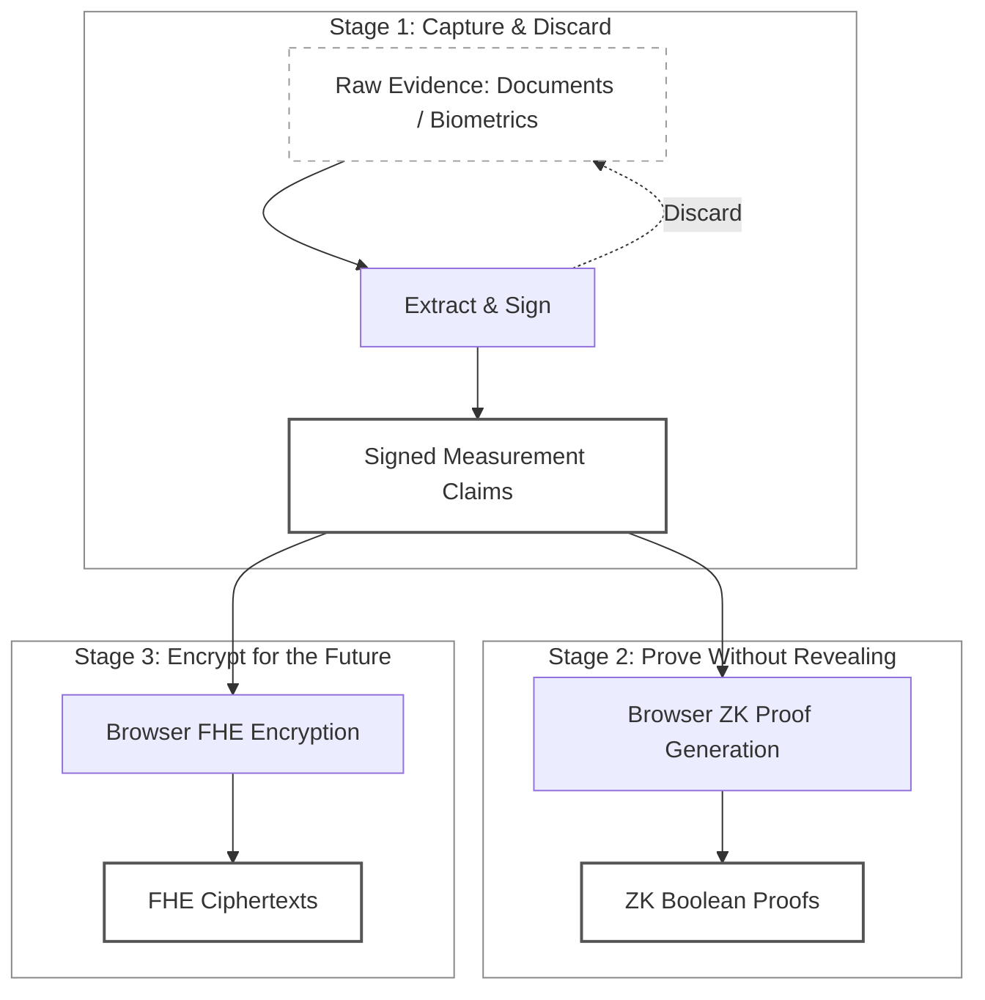
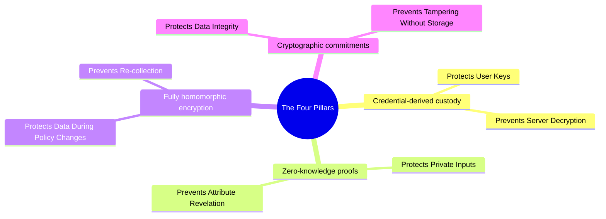

# Identity Verification Without Data Collection

**How cryptographic architecture eliminates the need to store personal data for compliance**

Every major identity breach shares the same root cause: **the data was there to steal**.

This is not a problem of a single company, a single industry, or a single failure of security practice; it is a structural pattern that has repeated every year for over a decade, with increasing scale, and it shows no sign of stopping.

<!-- BREACH_TIMELINE -->
- **2013.** **Yahoo**, 3 billion accounts. **Adobe**, 153 million user records.
- **2014.** **Marriott/Starwood**, 500 million hotel guests including **5.3 million unencrypted passport numbers**. Attackers remained in the system for four years before discovery.
- **2015.** **U.S. Office of Personnel Management**, 22.1 million federal employees and **5.6 million fingerprint** records. Anthem, 78.8 million patients. **Experian**, 15 million T-Mobile credit applicants' Social Security numbers and passport numbers.
- **2016.** **Uber**, **57 million riders and drivers**. The company paid the attackers $100,000 to delete the data and conceal the breach; the CSO was convicted of federal charges.
- **2017.** **Equifax**, **147.9 million** Americans' Social Security numbers, birth dates, and addresses. $1.38 billion in total costs.
- **2018.** **India Aadhaar**, 1.1 billion citizens' **fingerprints**, **iris scans**, and **photos**. A journalist could purchase any person's complete identity for **under $10** via a WhatsApp group. Facebook/Cambridge Analytica, 87 million profiles harvested for political targeting.
- **2019.** **Capital One**, 100 million customers and **140,000 Social Security numbers**. **Suprema BioStar 2**, **27.8 million records** including raw, unencrypted fingerprints from a biometric security provider used by banks, military contractors, and the UK Metropolitan Police. **Binance**, **60,000 users' passport scans** and **selfies** distributed via Telegram, traced to a third-party KYC vendor.
- **2020.** **Clearview AI**, a facial recognition database of **3 billion scraped images**, plus the client list revealing which law enforcement agencies use it. **Experian** South Africa, 24 million individuals.
- **2021.** **T-Mobile**, 76 million customers' Social Security numbers and driver's licenses. This was T-Mobile's **fifth known breach**.
- **2022.** **ICRC Red Cross**, **515,000 refugees** and displaced persons, including **their locations and family connections**. For this population, a data breach can be a death sentence. **Optus**, **9.5 million Australians' passport and driver's license numbers**, one-third of the country's population. **Medibank**, 9.7 million Australians' **medical records** including HIV status and mental health treatments, published on the dark web.
- **2023.** **MOVEit**, 93.3 million individuals across 2,700 organizations. **T-Mobile**, again (**eighth breach** since 2018). Indian Council of Medical Research, more than 300 million citizens' Aadhaar IDs and health records.
- **2024.** **National Public Data**, 2.9 billion records including **272 million Social Security numbers**. The company **filed for bankruptcy**. **AU10TIX**, the identity verification provider for **TikTok**, **Uber**, and **Coinbase**, had admin credentials compromised and left functional for eighteen months. **Change Healthcare**, 100 million Americans' health records.
- **2025.** **Coinbase**, **69,461 customers' government IDs**, **home addresses**, and KYC documents, stolen by bribed overseas support agents. $400 million in remediation. **PowerSchool**, up to 72 million students' and teachers' records including Social Security numbers and special education data. **SK Telecom**, 26 million subscribers' SIM authentication keys, stored unencrypted. Discord, 70,000 government-issued ID photos collected for age verification. **IDMerit**, a KYC verification provider: **one billion personal records across 26 countries**, including 204 million U.S. records, left on an **unprotected database** accessible to anyone on the public internet.
- **2026.** **Sumsub**, the KYC verification provider for **Bitget**, **Bybit**, **MEXC**, and other major crypto platforms, disclosed a breach that **had gone undetected for eighteen months**. The attack entered through a malicious attachment in a third-party support ticketing system in mid-2024; customer **names**, **email** addresses, and **phone numbers** across multiple platforms were exposed before anyone noticed.

**The pattern continues.** In 2025, U.S. data compromises hit an all-time record: **3,332 incidents**, a **79% increase** in five years, the third consecutive year above 3,000. Each year more organizations collect more identity data under regulatory mandate, and each year more of that data ends up in the hands of people it was never intended for. The collection-based model carries structural risk that scales with the data it requires.
<!-- /BREACH_TIMELINE -->

The financial cost is enormous (the FBI reported **$16.6 billion** in fraud losses for 2024 alone), but the human consequences are worse.

Leaked home addresses and identity documents have enabled a **169% surge in physical attacks** on cryptocurrency holders. A Ledger co-founder was kidnapped and had a finger severed. Multiple victims in France were abducted and tortured. A criminal ring in the United States received a 47-year sentence for home invasions involving waterboarding, using KYC data to locate and identify their targets. **These are not abstract risks**; they are the direct, documented consequences of centralized identity databases.

The regulations that mandate this data collection (KYC, AML, customer due diligence requirements across dozens of jurisdictions) were designed to prevent financial crime, but the industry has historically conflated *verification* with *collection*. The result is a structural tension: **regulations that mandate data collection create retention obligations that increase breach exposure.**

The **conflation is not inherent**. Verification and revelation are separable operations. A bank opening a new account needs to confirm that the applicant passes sanctions screening and meets age requirements; it does not need to store their passport scan. A cryptocurrency exchange needs to verify that a user's nationality is not on a restricted list; it does not need their document number. A wine delivery service needs to confirm a customer is of legal drinking age; it does not need their date of birth. A humanitarian organization needs to verify eligibility for aid; it does not need to store the refugee's location or family connections, precisely the information that becomes lethal when compromised.

The architecture described here uses credential-derived key custody, zero-knowledge proofs, and fully homomorphic encryption to satisfy these compliance requirements without storing plaintext personal data. Third parties receive boolean attestations through standard OAuth: `age_proof_verified: true`, `nationality_proof_verified: true`, `verification_level: 3`. Not a birth date. Not a passport number. Not a face scan.

> **The verification happened. The revelation didn't.**

## 1. Irreversible Exposure

Identity data differs from every other category of sensitive information in one critical respect: **it cannot be rotated**. A compromised password can be changed, and a stolen credit card can be reissued, but a compromised birth date remains compromised forever.

A leaked government ID number remains leaked. Attributes that can theoretically be changed, such as a legal name or residential address, remain exploitable in their breached form: the old data does not vanish from criminal databases when the new data is issued, and the period between breach and discovery is typically months or years.

This permanence makes identity data what security researchers call a **toxic asset**. It is not a resource that generates value for the organization holding it; it is a **liability** with a timer on it.

Every copy increases the attack surface, every retention period extends the window of vulnerability, and every institution performing identity verification creates another database that can be compromised. The cumulative effect is an ever-expanding map of targets for criminals who know exactly what that data is worth.

The industry's response has been to invest in perimeter security: encryption at rest, access controls, monitoring, and incident response. Financial institutions collectively spend **$61 billion annually** on compliance, with **$4.5 billion** on KYC alone. Yet databases continue to be left unprotected on the open internet, employee credentials remain functional for months after compromise, and insiders photograph screens with personal phones.

**Perimeter security addresses the symptom rather than the structural cause.** The data is still there, and the industry is increasingly asking not how to better secure it but whether the data needs to exist in that form at all.

---

The previous section established that identity data cannot be made safe by defending it harder. The next question is whether the data needs to exist.

## 2. Verification vs. Revelation

Verification and revelation are different operations, and compliance typically requires only the former.

Consider what organizations actually need. A bank onboarding a new customer must confirm their identity under CIP requirements, screen them against sanctions and PEP lists, and verify that they meet minimum age thresholds. The regulation requires these checks; it does not require the bank to permanently store the passport scan, the full date of birth, or the raw document.

The bank needs the answers to a set of questions: Is this person who they claim to be? Are they on a sanctions list? Are they old enough? **Each question has a yes-or-no answer.** What gets collected and retained is the underlying evidence, not because the answer requires it, but because the industry has not had a practical way to separate the two.

The same gap appears in every regulated context. A cryptocurrency exchange needs to know that a user's nationality returns *permitted* when checked against OFAC, EU, and UN sanctions lists; it does not need to store the nationality itself. A wine delivery service needs to confirm legal drinking age; it does not need the customer's date of birth. A humanitarian organization needs to confirm eligibility for aid, and storing identity documents, family connections, and current location is not just unnecessary but actively dangerous, as the ICRC breach of 515,000 refugee records demonstrated.

In each case, the regulation requires a **predicate**, a statement that evaluates to true or false. The industry has historically collected the **underlying data** and evaluated the predicate itself, because the tools to separate the two were not yet practical.

There is a spectrum of approaches to closing this gap. **Full disclosure** transmits raw data: the traditional model where a verifier receives the complete identity document. **Selective disclosure** allows the holder to share chosen attributes, which is a step forward, but the shared attributes are still raw values. A selectively disclosed birth date is still a birth date. **Zero-knowledge verification** is categorically different: the verifier learns only whether the predicate is satisfied. Not the value. Not even a partial value. Just the answer.

> The verification is necessary. The revelation is not.

This distinction is not theoretical; it is implementable with existing cryptographic primitives and compatible with existing compliance frameworks.

---

The previous section established the conceptual separation. What follows is the mechanism that makes it operational.

## 3. The Three-Stage Transformation

The architecture transforms identity evidence through three stages. Each stage has a specific purpose, and the boundaries between stages determine what persists and what is discarded.

### 3.1 Integrity Without Retention

The first stage handles raw evidence: identity documents and biometric captures. The critical property is that this evidence is **transient**. It exists only long enough to extract measurements, then it is discarded.

When a user uploads an identity document, optical character recognition extracts the relevant fields: name, date of birth, document number, expiry date, and nationality. The server signs the extracted measurements with its private key, producing a *signed claim*. These signatures are openly verifiable by relying parties, ensuring the server cannot quietly alter its attestations later.

The original document image is then discarded; it is not written to any database, not stored in any file system, not retained in any cache. What persists is the server's attestation that it observed specific measurements from a document at a specific time.

Liveness verification follows the same pattern. The user completes a multi-gesture challenge (turning their head, blinking, and speaking a phrase) while the system captures video frames. The system scores the face match between the liveness capture and the document photo, signs the score as a claim, and discards the video frames and facial images. What persists is the server's attestation that a live person matched the document photo above a confidence threshold.

This stage establishes **integrity without retention**. The server is trusted to accurately extract measurements and honestly sign them, but it is not trusted to store them. The signed claims carry the server's authority. The raw evidence does not need to persist for that authority to remain valid.

| What enters | What persists | What is discarded |
|---|---|---|
| Document images | Signed measurement claims | All images |
| Liveness video frames | Signed face match score | All video data |
| Biometric captures | Signed liveness attestation | All biometric data |

### 3.2 Proof Without Revelation

The second stage takes the signed claims from the first stage and generates cryptographic proofs: statements that a predicate is true, without revealing the underlying value.

These proofs are generated **in the user's browser**. The private inputs (date of birth, nationality, and biometric similarity score) never leave the client. They are stored locally or fetched from an encrypted cloud payload called a **Sealed Profile** that only the user can decrypt.

The browser takes the signed claims, constructs the proof locally, and submits only the proof to the server. The server verifies that the proof is valid and that the claims were signed by its own key; it learns nothing about the underlying values.

For age verification, the proof demonstrates that the user's date of birth yields an age that meets or exceeds a threshold. The server learns "this person is at least 21," but it does not learn whether they are 22 or 45 or 92, does not learn their birth date, and receives only the boolean.

For nationality membership, the proof uses a Merkle tree containing the permitted countries. The user proves that their nationality is a member of the tree, and the server learns only that "this person's nationality is in the permitted set," not which country.

For face matching, the proof demonstrates that the similarity score between the liveness capture and the document photo exceeds a threshold. The server learns "this person's face matches their document above the required confidence level," but it does not learn the score itself or receive any biometric template.

The trust model here is deliberate. The browser is trusted for **privacy** (private inputs stay on the client) but not for **integrity** (the inputs must match the server's signed claims, so the user cannot fabricate their birth date or nationality). The server is trusted for **integrity** (it signs accurate measurements) but not for **privacy** (it never sees the private inputs). **Neither party needs to be fully trusted. The cryptography enforces the boundary.**

Identity binding prevents one user's proofs from being replayed by another. Each proof is bound to the user's authentication credential and a server-generated nonce with a short expiration window, which means a valid proof from one user is not a valid proof for a different user.

### 3.3 Durability Without Re-collection

ZK proofs are one-time: a proof that demonstrates "this person is at least 18" is valid at the time of generation, but it cannot answer a different question later.

Regulations change: a jurisdiction may raise an age threshold from 18 to 21, sanctions lists are updated quarterly, and compliance requirements evolve as new legislation takes effect. If the architecture relies solely on ZK proofs, any change in policy requires the user to re-verify: re-upload their document, repeat the liveness check, and generate new proofs.

Fully homomorphic encryption addresses this limitation. FHE allows computation on encrypted data without decrypting it. The server can evaluate a new policy ("is this person at least 21?") against encrypted values without ever seeing the plaintext.

During the initial verification, the user's date of birth (converted to a numeric representation) is encrypted under the user's FHE public key. The encrypted value, the *ciphertext*, is stored on the server. When a policy changes and the threshold increases from 18 to 21, the server performs the comparison directly on the ciphertext. The result is another ciphertext (an encrypted boolean) that only the user can decrypt. No re-verification needed. No new document upload. No new liveness check.

The critical difference from conventional encryption is operational. With standard encryption, the server must decrypt the data to compute on it, which means the server needs the key, which means **a breach of the server exposes the data**. With FHE, the server computes on ciphertext and produces ciphertext. **It never needs the decryption key. It never sees the plaintext.** The user holds the only key that can decrypt the result.

This raises the question of key custody. If the server held the FHE decryption key, a breach would expose the ability to decrypt every ciphertext in the database, recreating the honeypot problem. The key custody model, described in the next section, ensures that the user holds the key and the server cannot access it.

The attributes suited for FHE are low-dimensional, policy-dependent values: birth year, country code, and compliance level. High-dimensional data like face embeddings remain in the ZK domain, where one-time proofs are sufficient. The architecture uses ZK for static predicates and FHE for dynamic policies, applying each technology where it is strongest.

---

The three stages describe what happens to data. The four primitives described next explain why each transformation is trustworthy.

## 4. The Four Pillars

The three-stage transformation relies on four cryptographic primitives that interlock. Each addresses a different gap in the privacy model. They differ in *what* they protect: keys, inputs, data durability, or integrity. Removing any one reopens the gap it was designed to close.

| Pillar | What it protects | Without it |
|---|---|---|
| Credential-derived custody | User's encryption keys | The server can decrypt, and the database becomes a honeypot |
| Zero-knowledge proofs | Private inputs during verification | Attributes must be revealed to prove eligibility |
| Fully homomorphic encryption | Data during policy re-evaluation | Policy changes require re-collecting evidence |
| Cryptographic commitments | Data integrity without storage | There is no way to verify that values were not altered after the fact |

Consider how these interlock in a single scenario. A bank needs to confirm that a customer meets a minimum age requirement.

The user's credential (a passkey, a password via OPAQUE, or a wallet signature) unlocks a sealed profile containing the date of birth. A zero-knowledge proof demonstrates that the age exceeds the threshold, without revealing the birth year. A cryptographic commitment allows later integrity verification: did this value change since the original document was processed? An FHE ciphertext encrypts the date of birth so that future policy changes can be evaluated without re-verification. Four primitives. One verification. No plaintext stored.

For the full cryptographic architecture, see the [Cryptographic Pillars](../../../cryptographic-pillars.md) documentation.

**Commitments** are worth highlighting because they are the least visible pillar. A commitment is a one-way hash: `SHA-256(value + user_salt)`. The server stores only the hash, and the salt lives in the user's sealed profile, accessible only with their credential.

Later, the system can recompute the hash to verify that a value has not been tampered with, **without storing or re-collecting the original value**. Deleting the sealed profile **breaks linkability entirely**, because the commitments become irreversible without the salt.

**Credential-derived custody** unifies authentication and identity protection. Traditional systems treat authentication and KYC as separate concerns handled by separate vendors. This architecture merges them: the user's login credential *is* the mechanism that protects their identity data. Without the credential, the data is inaccessible, not because of an access control policy, but because of mathematics.

The model is analogous to a safe deposit box with multiple locks. Any key opens it, and three different keys, each held by a different person, all grant access to the same contents. **Lose one key, use another. Add a new key without changing what is inside.** The architecture supports three credential types:

**Passkeys** use the WebAuthn PRF extension to derive a key from hardware-backed authentication. The secret never leaves tamper-resistant hardware: a security chip, a hardware key, or a phone's secure enclave. **A breach of the server yields nothing.**

**Passwords** use the OPAQUE protocol. **The server never sees the password: not during registration, not during login, not ever.** The protocol produces an *export key* on the client side that wraps the encryption keys. The server stores an OPAQUE registration record that cannot be used for offline dictionary attacks.

**Wallet signatures** use deterministic EIP-712 signatures derived through HKDF. A hardware wallet signs a structured message, producing a deterministic output that feeds into key derivation. Web3-native users custody their identity data with the same wallet they use for transactions.

All three paths produce the same result: a key-encryption key that wraps the data-encryption key protecting the user's identity data. **The server stores the encrypted blob and the wrapped key, but it cannot unwrap it.** Multiple credentials can wrap the same data key simultaneously, providing redundancy without duplicating the protected data.

> Verify once. Use the credential everywhere it is accepted. Each relying party receives only what it needs. No additional copies of the data are created.

---

The four pillars explain what each primitive contributes. The next question is why neither the browser nor the server needs to be fully trusted.

## 5. Complementary Trust

The architecture partitions trust between two parties that are each hostile in different ways. The browser is hostile for integrity: any value computed on the client can be forged. The server is hostile for privacy: any plaintext it receives, it could leak. **Neither party needs to be fully trusted. The cryptography enforces the boundary.**

This partition produces a complementary verification model. The server performs document extraction, liveness detection, and face matching, then signs the results as claims. The client generates zero-knowledge proofs over those signed values, keeping the private inputs in the browser, and the server verifies the proofs and confirms that the claims carry its own signature.

**An attacker who controls the browser cannot forge the server's signed measurements. A compromised server cannot access the private inputs that the browser used to generate the proofs.**

Specific attack vectors are addressed by construction. A selfie substitution attack, where a user passes liveness with their own face and then submits a different photo for the face match, is blocked because the server stores a hash of the verified selfie frame during liveness. The face match endpoint requires that the submitted image hash matches the stored liveness hash before processing. **The binding is cryptographic, not procedural.**

Every completed verification produces an evidence pack: a signed bundle containing a policy hash and a proof set hash. This evidence demonstrates that verification occurred and that the user satisfied specific predicates at a specific time, without containing any plaintext PII. **Regulators and auditors can verify the evidence pack without accessing the underlying personal data.**

For the complete threat model, see the [Tamper Model](../../../tamper-model.md) documentation.

> Privacy: the client retains sensitive inputs; proofs reveal only eligibility. Integrity: the server verifies all claims with proofs and signatures. Auditability: signed evidence packs enable durable audits without storing personal data.

---

Complementary trust explains how a single verification works. The next question is how the system handles users at different stages of verification.

## 6. Progressive Assurance

Authentication strength, identity proofing depth, and proof completeness are independent properties. **A single integer "Level" conflates them**, producing authorization rules that are either too coarse or too fragile.

The architecture separates assurance into three axes. **Authentication strength** measures how confidently the system knows it is the same person returning: a hardware-backed passkey provides stronger assurance than a password, which provides stronger assurance than a session cookie.

**Identity proofing depth** measures how confidently the system knows who the person is: document verification with liveness and face matching provides stronger assurance than self-asserted information, which provides stronger assurance than none.

**Proof completeness** measures what cryptographic artifacts exist: on-chain attestation provides stronger assurance than a full set of zero-knowledge proofs, which provides stronger assurance than server-signed claims alone.

From these axes, the system derives four access tiers:

| Tier | Meaning | Unlocked capabilities |
|---|---|---|
| 0 | No account | Public browsing only |
| 1 | Authenticated, keys secured | Dashboard access, sealed profile, FHE key enrollment |
| 2 | Identity verified | Verification results visible, can generate ZK proofs |
| 3 | Auditable | On-chain attestation, credential issuance, regulated disclosure |

Users create an account and reach Tier 1 without providing identity documents. Verification happens later, from the dashboard, when the user is ready. **This progressive model reduces friction without weakening the cryptographic guarantees**, because the underlying proof architecture is modular: proofs are individually policy-bound, and generating additional proofs later does not invalidate prior work.

The taxonomy is inspired by NIST SP 800-63, eIDAS, and OpenID Connect Identity Assurance, adapted to the architecture's specific combination of authentication, identity proofing, and cryptographic evidence.

---

Progressive assurance defines what the architecture measures. The next question is whether those measurements satisfy existing regulatory frameworks.

## 7. Regulatory Alignment

Every regulatory framework in this section requires verification. They differ in a single dimension: **when and whether they also require revelation**. GDPR prohibits unnecessary collection entirely. AMLR requires artifact retention but not plaintext. FinCEN permits revelation under specific audit scenarios. eIDAS and FATF explicitly recognize privacy-preserving techniques as compliant.

The technology is identical across all these frameworks. The same ZK proofs, the same FHE, the same credential-derived custody serve each one. What varies is the policy boundary: how much revelation is required, and under what conditions.

**GDPR Articles 5 and 25** mandate data minimization and privacy by design. The architecture is natively data-minimal: **plaintext PII is processed transiently and never stored at rest**. Only cryptographic artifacts persist. Privacy is not a retroactive measure applied to existing data stores; **it is a consequence of the data model.**

**AMLR Article 77** requires retention of verification records for five years. The architecture retains signed measurement claims, ZK proof verification results, and FHE-encrypted attributes for the required period. These artifacts demonstrate that verification occurred and that the user satisfied the required predicates. **They do not contain plaintext PII because plaintext PII was discarded at the point of extraction.**

**eIDAS 2.0** establishes EU-wide Digital Identity Wallets by the end of 2026, with mandatory private-sector acceptance by 2027. Article 5a explicitly mentions zero-knowledge proofs as a recognized privacy-preserving technique. The architecture supports OIDC4VCI and OIDC4VP for wallet-compatible credential issuance and presentation, and SD-JWT for selective disclosure, positioning it as a natural implementation of the eIDAS vision.

**FinCEN's Customer Identification Program** requires identity verification and record maintenance. The architecture verifies identity through the three-stage transformation and maintains verification records as cryptographic artifacts. For specific audit scenarios where regulators require access to underlying data, the architecture supports regulated disclosure through identity-scoped OAuth claims, delivered ephemerally and not persisted.

**FATF Recommendation 10** requires Customer Due Diligence. The FATF's June 2025 updated guidance explicitly recognizes zero-knowledge proofs and homomorphic encryption as tools for privacy-preserving AML compliance. The architecture's dual-track model (ZK for static predicates, FHE for dynamic policies) maps directly to this guidance.

For re-verification in regulated environments (when thresholds change, when sanctions lists are updated, when new policies take effect), the FHE layer allows computation on encrypted attributes without re-collecting evidence. The server evaluates the new policy against existing ciphertexts, and the user decrypts the result. **No new document upload. No new liveness check. No new exposure of personal data.**

---

Regulatory alignment addresses whether the architecture satisfies existing frameworks. The architecture also extends verification into contexts beyond the original relying party.

## 8. Durable Verification

Verification results must survive beyond the moment they are generated. The use cases in this section share a common structure: carrying verified trust into a new context without recreating the data collection problem. They differ in *what the verification must survive*: movement between parties, movement to public ledgers, or the advancement of computational power.

**Portable credentials** carry trust across relying parties. The architecture issues verifiable credentials following OpenID standards (OIDC4VCI for issuance, OIDC4VP for presentation). **Credentials contain derived claims only**, verification flags such as `age_proof_verified` and `document_verified`, never raw PII.

The trust model follows the SSI triangle: Zentity verifies and issues, the user holds and controls, and relying parties verify without contacting Zentity. Each relying party sees a different pairwise identifier, **preventing cross-RP correlation**. SD-JWT selective disclosure lets users reveal only the claims each party needs.

This model enables seamless third-party integration through standard OAuth 2.1 and OpenID Connect. A relying party initiates a standard OAuth flow, the user authenticates (which unlocks their identity data client-side), and the system issues a token containing only the requested claims: `age_proof_verified: true`, `liveness_verified: true`. Identity scopes containing actual PII are **delivered through an ephemeral, in-memory channel with a five-minute time-to-live, consumed on read, never written to any database**.

For the full credential architecture, see the [SSI Architecture](../../../ssi-architecture.md) documentation.

**On-chain compliance** carries trust to public ledgers. For blockchain-native applications, the architecture extends to encrypted on-chain attestation via fhEVM (fully homomorphic Ethereum Virtual Machine). **Identity verification stays off-chain; only encrypted attestations are submitted to smart contracts.** The contracts evaluate compliance policies directly on ciphertext, never seeing plaintext dates of birth, nationalities, or compliance scores.

Users grant contracts access to their encrypted attributes through an explicit ACL model. Compliance checks that fail return an encrypted "false" rather than reverting the transaction, preventing on-chain status leakage.

For the full blockchain integration, see the [Web3 Architecture](../../../web3-architecture.md) documentation.

**Post-quantum durability** carries trust across time. Compliance documents have multi-year retention requirements, and recovery wrappers persist for the lifetime of an account. The "harvest now, decrypt later" threat, where an adversary captures ciphertext today and waits for a quantum computer to break it, is concrete for these timelines.

The architecture uses ML-KEM-768 (FIPS 203) for key encapsulation and ML-DSA-65 (FIPS 204) for credential signing, both NIST post-quantum standards finalized in August 2024. The ciphertext stored today is designed to remain secure through and beyond the retention period.

---

Durable verification shows where the architecture reaches. The practical test is what remains when the defenses fail.

## 9. What a Breach Finds

The practical test of any privacy architecture is what an attacker obtains after a successful breach.

| Data type | Collection-based breach | This architecture |
|---|---|---|
| Names | Plaintext, immediately usable | Not stored |
| Dates of birth | Plaintext, immediately usable | FHE ciphertext (no decryption key on server) |
| Addresses | Plaintext, enables physical targeting | Not stored |
| Passport/ID numbers | Plaintext, enables identity theft | Not stored |
| Document images | Plaintext scans, forgeable | Discarded after extraction |
| Biometric templates | Raw embeddings, permanently compromising | Discarded after scoring |
| Face images | High-resolution photos | Discarded after liveness check |
| Verification status | Account flags | ZK proofs (reveal only booleans) |
| Encryption keys | Often co-located with encrypted data | Wrapped by user credential (never on server) |
| Key encapsulation | Classical encryption (quantum-vulnerable) | ML-KEM-768 (quantum-resistant) |

In a collection-based breach, an attacker walks away with a complete identity profile: name, address, birth date, document scans, and biometric data. **Every record is immediately exploitable.** The IDMerit breach exposed over a billion such records, and the Coinbase breach **turned 69,461 records into targets for physical violence.**

In this architecture, an attacker who gains full access to the server's database finds: encrypted blobs indistinguishable from random bytes, wrapped data-encryption keys equally indistinguishable, one-way cryptographic hashes that cannot be reversed, ZK proofs that reveal only boolean verification results, and FHE ciphertexts that can be computed upon but never decrypted without the user's key.

None of this data is usable without the user's authentication credential: a passkey in hardware, a password the server has never seen, or a wallet signature. The attacker would need to compromise each individual user's credential to access each individual user's data. **There is no master key. There is no bulk decryption.**

A quantum adversary faces the same gap. The key encapsulation uses ML-KEM-768, a lattice-based scheme resistant to Shor's algorithm, and the data-encryption keys are wrapped under user credentials that the server never holds. **The database is not a honeypot because it contains nothing worth stealing.**

> The protection is not a policy. It is a mathematical gap. The server does not choose to keep the data private. It is unable to make it public.

## 10. Conclusion

The tension between compliance and privacy is not inherent; it arises from implementation choices, not from fundamental constraints.

The same standards that enable centralized data collection can be composed differently, using the same regulatory frameworks, the same authentication standards, and the same identity verification processes, to produce an architecture where verification occurs without collection.

**The technologies involved are not speculative.** Zero-knowledge proofs, fully homomorphic encryption, credential-derived key custody, and standards-based OAuth are all **implementable today with audited, open-source primitives**. WebAuthn PRF is a W3C standard, OPAQUE is published as RFC 9807, UltraHonk and TFHE are actively developed and benchmarked, and OAuth 2.1 and OpenID Connect are industry-adopted protocols.

The composition is what differs. The four pillars each address a specific gap, and **together they produce a system where compliance and privacy are not in tension.** Without credential-derived keys, the server can decrypt; without server-signed measurements, clients can forge inputs; without ZK proofs, attributes must be revealed; without FHE, policy changes require re-verification; without commitments, integrity cannot be verified after the fact; without standard OAuth, credentials are not portable. **Each component closes a gap that the others leave open.**

The breaches described at the opening of this paper share a single root cause: the data was there to steal. The best perimeter security, the largest compliance budget, the most sophisticated monitoring system cannot change this fact. As long as the data exists in accessible form, it will eventually be accessed by someone who should not have it.

**The only sustainable defense is architectural.** Design the system so that the server never has what it should not have. **Replace data with proofs. Replace storage with computation on ciphertext. Replace server-held keys with user-held credentials.**

The technology exists, the standards exist, and the regulatory alignment exists; the question is whether we choose to deploy it.

---

**Ready to separate verification from collection?**
[Explore the open-source architecture](https://github.com/gustavovalverde/zentity) or [read the integration documentation](../../../oauth-integrations.md) to start building with Zentity.
