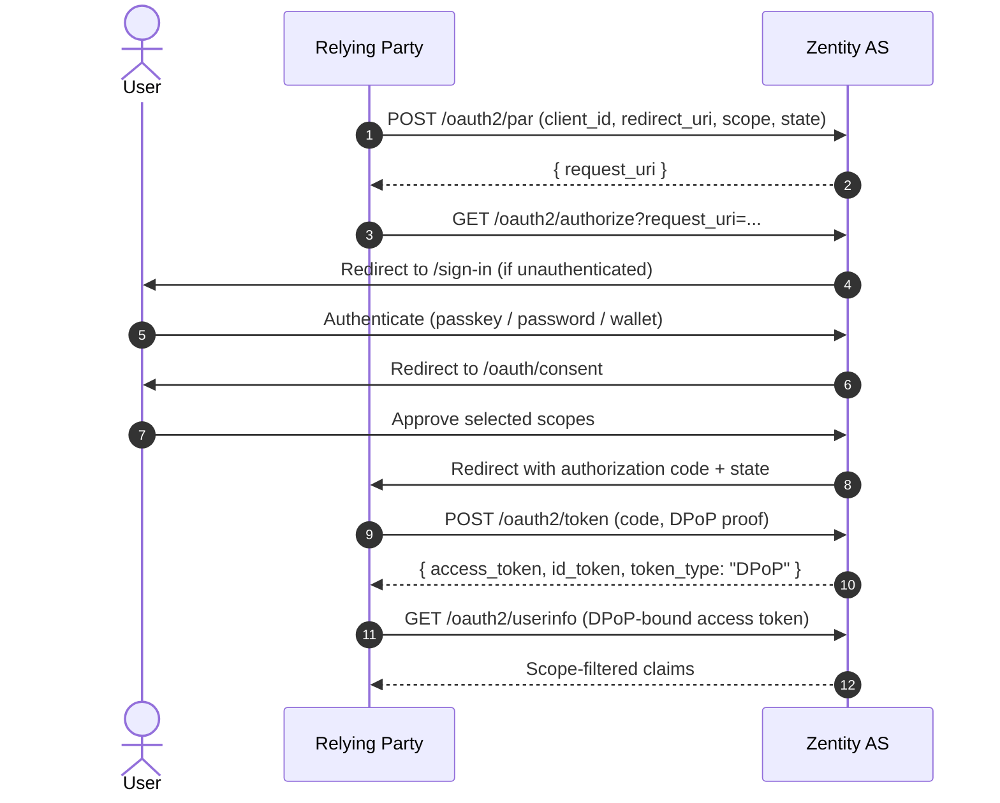
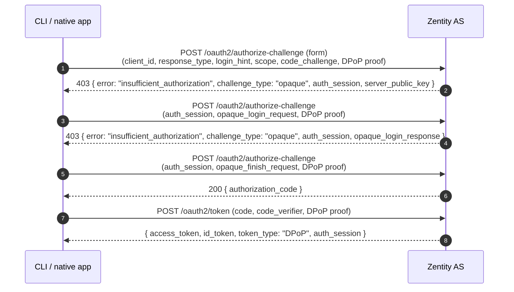
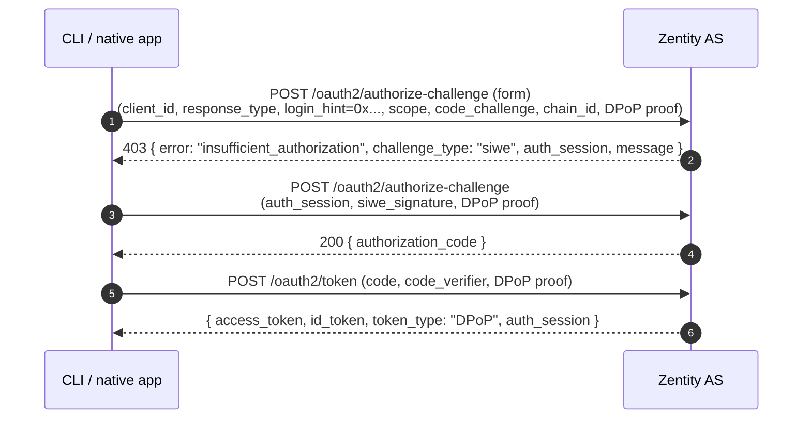
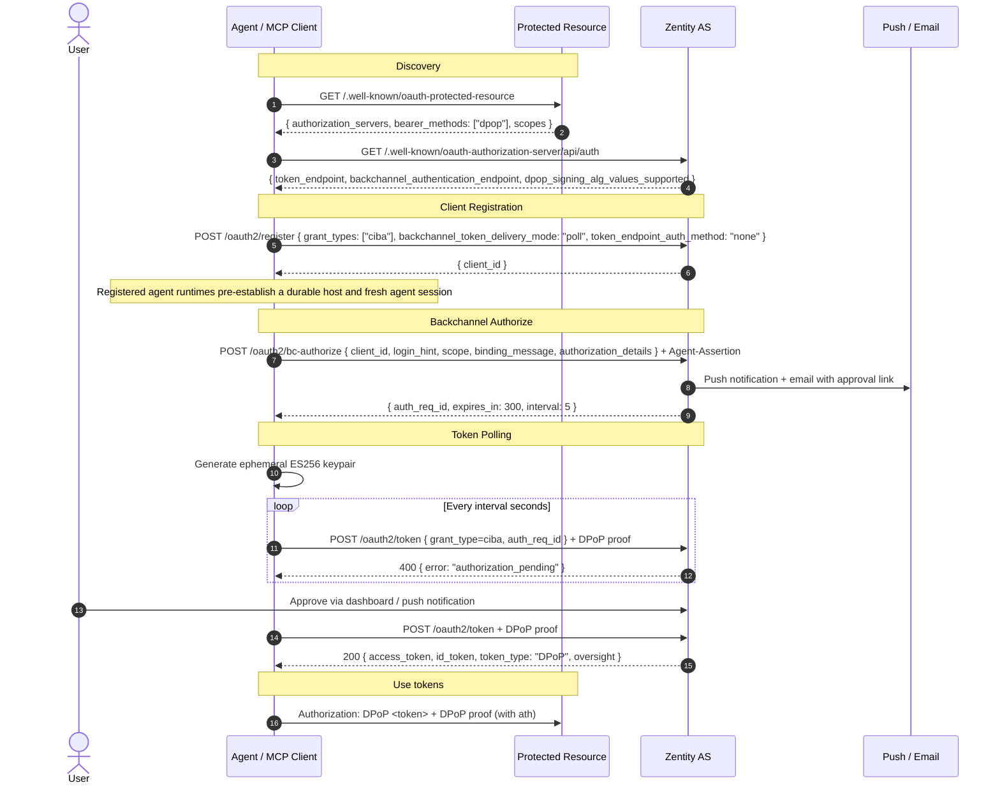
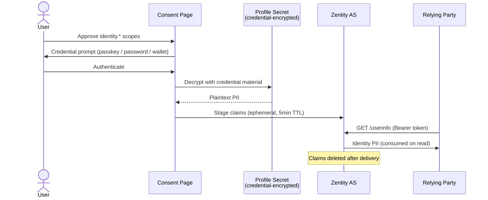

Zentity's OAuth integration implements a zero-PII authorization model: relying parties receive cryptographically verified identity claims without the server ever storing or transmitting plaintext personal data. This document maps the protocol surface area from endpoints through token security to privacy guarantees, with the delivery mechanism (scope-based, credential-based, or backchannel) as the axis of variation.

## Endpoints

The endpoints below cluster by lifecycle stage: discovery, authorization, token exchange, user data, client management, and CIBA.

### Discovery

| Endpoint | Standard | Purpose |
| --- | --- | --- |
| `GET /.well-known/oauth-protected-resource` | RFC 9728 | Protected resource metadata (AS pointers, scopes, bearer methods) |
| `GET /.well-known/oauth-authorization-server/api/auth` | RFC 8414 | Authorization server metadata |
| `GET /api/auth/.well-known/openid-configuration` | OIDC Discovery | OpenID Connect discovery |

### Authorization

| Endpoint | Standard | Purpose |
| --- | --- | --- |
| `POST /api/auth/oauth2/par` | RFC 9126 | Pushed Authorization Request (optional) |
| `GET` or `POST /api/auth/oauth2/authorize` | OAuth 2.1 | Authorization request (interactive; query string or form-encoded body) |
| `POST /api/auth/oauth2/bc-authorize` | OIDC CIBA | Backchannel authorization (headless) |
| `POST /api/auth/oauth2/consent` | OAuth 2.1 | User consent submission |
| `POST /api/auth/oauth2/authorize-challenge` | draft-ietf-oauth-first-party-apps | First-party app challenge (headless, no redirect) |

### Tokens

| Endpoint | Standard | Purpose |
| --- | --- | --- |
| `POST /api/auth/oauth2/token` | OAuth 2.1 | Token exchange (all grant types) |
| `POST /api/auth/oauth2/introspect` | RFC 7662 | Token introspection |
| `POST /api/auth/oauth2/revoke` | RFC 7009 | Token revocation |
| `GET /api/auth/oauth2/jwks` | RFC 7517 | Public signing keys (RSA, Ed25519) |

### User data

| Endpoint | Standard | Purpose |
| --- | --- | --- |
| `GET /api/auth/oauth2/userinfo` | OIDC Core | Scope-filtered verified claims + identity PII (sole PII delivery endpoint) |
| `GET /api/auth/oauth2/validity` | (custom) | RP pull endpoint for current identity-validity state of the authenticated pairwise subject |
| `GET /api/auth/oauth2/end-session` | OIDC Session | Session logout |

### Client management

| Endpoint | Standard | Purpose |
| --- | --- | --- |
| `POST /api/auth/oauth2/register` | RFC 7591 | Dynamic Client Registration |
| `GET /api/auth/oauth2/get-consents` | (custom) | List user's active consents |
| `POST /api/auth/oauth2/delete-consent` | (custom) | Revoke a consent grant |
| `POST /api/auth/oauth2/update-consent` | (custom) | Update consented scopes |

### CIBA lifecycle

| Endpoint | Purpose |
| --- | --- |
| `GET /api/auth/ciba/request?request_id=...` | Fetch a pending request addressed to the signed-in user (for the approval page) |
| `POST /api/ciba/identity/intent` | Acquire intent token for PII staging (binds user + CIBA request + scopes) |
| `POST /api/ciba/identity/stage` | Stage vault-unlocked PII with intent token (ephemeral, 10-min TTL) |
| `POST /api/auth/ciba/decision/options` | Passkey assertion options bound to the request and the session, for an approval that needs user verification: `{ request_id }` |
| `POST /api/auth/ciba/decision` | Approve or deny a pending CIBA request: `{ request_id, decision: "approved" \| "denied", channel: "page" \| "push" \| "email", webauthn? }` |
| `POST /api/ciba/push/subscribe` | Register browser push subscription for CIBA notifications |
| `POST /api/ciba/push/unsubscribe` | Remove push subscription |

### Internal validity operations

| Endpoint | Purpose |
| --- | --- |
| `POST /api/internal/validity/chain` | Admin-key trigger for chain revocation ingress |
| `POST /api/internal/validity/freshness` | Admin-key trigger for scheduled freshness evaluation |

---

The endpoints above define the protocol surface. The next section traces the three authorization paths that traverse these endpoints, each optimized for a different client context.

## Authorization Flows

Zentity supports three authorization paths. All require DPoP and produce the same token format. They differ in where the user is present: in the RP's browser (interactive), at a CLI (first-party challenge), or on a separate device (CIBA).

### Interactive (browser redirect)

For traditional web applications where the user is present at the RP.



**Grant type**: `authorization_code`

PAR is optional: a client may push its authorization request to the PAR endpoint and pass the returned `request_uri` (60-second TTL) to the authorize endpoint, or send the request parameters directly, in the query string of a GET or the form-encoded body of a POST. Zentity applies the same `acr_values` step-up check to both.

### First-Party Challenge (headless, no redirect)

A first-party native or command-line app signs the user in without a browser redirect: it posts the user's identifier and credentials to the Authorization Challenge Endpoint, receives an authorization code, and redeems it at the token endpoint. Zentity implements `draft-ietf-oauth-first-party-apps-04` with the `@better-auth/first-party-apps` plugin, which owns the protocol framing, and its own credential methods in `src/lib/auth/oidc/first-party-apps.ts`.

**Client requirements**: an administrator registers the client and sets both `first_party` and `skip_consent` on it. Dynamic registration cannot set either, so a registrant cannot declare itself first-party. Any other client gets 400 `unauthorized_client`. A confidential client authenticates on every request, as at the token endpoint.

**Request rules**:

- The initial request is `application/x-www-form-urlencoded` and carries `client_id`, `response_type=code`, `login_hint` (an email or wallet address), `scope`, and PKCE (`code_challenge`, `code_challenge_method=S256`). It may also carry `resource`, `claims`, `acr_values`, and, for wallets, `chain_id`.
- Later requests carry the `auth_session` and the answer to the current challenge, form-encoded or JSON.
- Every request carries a DPoP proof from the same key. The first proof binds the `auth_session` and the code to that key.
- No request carries a `redirect_uri`. The code is bound to none, so the token request omits it too.

#### OPAQUE flow (3 rounds)



#### Sign-In with Ethereum flow (2 rounds)



**Credential resolution**: OPAQUE comes first, then Sign-In with Ethereum, then `redirect_to_web`. The hint decides which method can answer:

- A wallet address always gets a Sign-In with Ethereum challenge, even for a user who also has a password. An unknown address gets a challenge with the same fields, and no signature completes it. Without `chain_id`, the message names chain 1 whether or not the address is registered, so the challenge never reveals an account.
- An email gets an OPAQUE challenge. An unknown email gets the same challenge, backed by a dummy registration record, so it takes as long as a real one and fails at the last round.
- An email whose account has no OPAQUE password, such as a passkey-only or wallet-only account, gets 403 `redirect_to_web`. The response never contains the account's wallet address, although it does show that the email has an account.

A client that receives `redirect_to_web` starts its own browser authorization code flow with PKCE and a redirect URI it controls. The SDK's installed client (`createInstalledClientAuth`) signs in through that browser flow directly: it uses a loopback `redirect_uri` and pushes the request through PAR when discovery advertises a PAR endpoint.

**Responses** (draft §5.2):

| Condition | Status | `error` |
| --- | --- | --- |
| Code issued | 200 | none, body `{ authorization_code }` |
| Next challenge | 403 | `insufficient_authorization`, with `auth_session`, `challenge_type`, and the challenge fields |
| Wrong credential | 400 | `authentication_failed`, with `auth_session` and a fresh challenge |
| The sign-in worked, but the code waits for a higher assurance tier | 403 | `insufficient_authorization`, with `auth_session` and no `challenge_type` |
| The browser must take over | 403 | `redirect_to_web` |
| Unknown, expired, or ended `auth_session` | 400 | `invalid_session` |
| Missing proof, or a proof from another key | 400 | `invalid_dpop_proof` |

Every response carries `Cache-Control: no-store`. Only an HMAC of each `auth_session` is stored, and the token response returns a new `auth_session` that replaces the one the rounds used.

**Wallet message**: `message` is an EIP-4361 message that the AS builds. Its domain and URI are the app origin from `NEXT_PUBLIC_APP_URL`, its statement is `Sign in to Zentity from a first-party app.`, and its Request ID is a random value kept with the message in the `auth_session`'s method state, which the plugin encrypts. The client signs it with EIP-191 `personal_sign` (the SDK's `WalletAuthorizationStrategy.signMessage`), and the AS verifies the signature as an ECDSA signature from the wallet's own key (EOA). The message's nonce is single-use and expires with the message, five minutes after it is issued. A wrong signature, or one over an expired message, gets 400 `authentication_failed` with a new message. Each request claims the `auth_session` for one response, so concurrent finish rounds with the same signature yield at most one authorization code, and the others get 400 `invalid_session`. The browser sign-in and sign-up messages carry different statements and no Request ID, so a signature made for one of them is refused here, and a first-party signature is refused by the browser endpoints.

**Two-factor authentication**: a user with two-factor enabled gets `redirect_to_web` after their password or signature verifies, and no code. The check runs only after a credential verified, so the earlier responses do not reveal enrollment.

**Assurance tiers**: when the request's `acr_values` ask for a higher tier than the user holds, the verified sign-in creates a session but no code, and the endpoint answers 403 `insufficient_authorization` without `challenge_type`. The client presents the same `auth_session` again once the user's tier has risen, for example after identity verification in the browser. The retry issues the code on the session from that sign-in and asks for no credential.

**Sessions**: each sign-in creates a session that lasts 24 hours and records an `authentication_contexts` row with `sourceKind` `authorize_challenge_opaque` or `authorize_challenge_eip712`, which supplies the ID token's `amr`. The provider treats tokens whose session has ended as inactive, so the session lifetime also bounds the tokens.

**Step-up at the token endpoint**: when a CIBA token poll fails the request's `acr_values`, Zentity calls the plugin's `challengeFirstPartyStepUp` for the CIBA request's client. A confidential first-party client gets HTTP 403 `{ error: "insufficient_authorization", auth_session }`, bound to the poll's DPoP key. The client presents that `auth_session` with a new PKCE challenge at the challenge endpoint, signs the user in again, and redeems the code for tokens once the tier requirement is met. The CIBA grant has no session or DPoP binding of its own, so a public client gets 400 `interaction_required`. A CIBA request with `authorization_details`, such as a payment approval, also gets `interaction_required`, because an authorization code cannot carry them.

**Abuse limits**: 10 requests per minute per IP, three failed responses per `auth_session` before `redirect_to_web`, and ten failed responses per account and method in 15 minutes. A locked account answers `authentication_failed` even for a correct credential, so a guesser cannot tell the lock from a wrong guess. The per-IP limit uses Better Auth's rate limiter, which keeps its counters in memory on each instance; the other limits live in the database. Each challenge request deletes `auth_session` rows past their expiry and failure counters whose 15-minute window has passed, so abandoned flows do not build up.

### Headless (CIBA)

For agents and background services where the user approves from a separate device. This is the path MCP clients take.



**Grant type**: `urn:openid:params:grant-type:ciba`

**Tokens**: every CIBA access token names its actor in `act` (RFC 8693 §4.1): the verified agent session for an agent request, otherwise the client. A refreshed token would no longer name the actor, so the CIBA grant returns no refresh token, even when `offline_access` is granted.

**Registration**: a CIBA client must register `backchannel_token_delivery_mode` as `poll` or `ping`. Registration without a supported delivery mode fails with `invalid_client_metadata`.

**Request encoding**: `POST /oauth2/bc-authorize` accepts only `application/x-www-form-urlencoded` bodies (CIBA Core §7.1). Send `authorization_details` as a JSON-encoded array in a string parameter. Zentity accepts three types, the ones discovery lists in `authorization_details_types_supported`: `payment_authorization`, `purchase`, and `x402_purchase`. Each has a strict schema in `@zentity/sdk/protocol` (`AUTHORIZATION_DETAILS_TYPES`). A value that is not a valid JSON array, a detail of another type, more than one payment or purchase entry, or an entry with an unknown, missing, or invalid field gets `invalid_authorization_details` (RFC 9396 §5). `binding_message` must be plain text of at most 64 characters, or the request gets `invalid_binding_message`. `truncateBindingMessage` from `@zentity/sdk/protocol` shortens a longer message; shorten it before you show it to the user or hash it into an `Agent-Assertion`.

**Payments**: a client that sends `payment_authorization` entries registers `authorization_details_types: ["payment_authorization"]` (RFC 9396 §10); a client that did not gets `invalid_authorization_details`. No scope marks a payment: the entry does, with `scope=openid` or alongside proof and identity scopes. Zentity sets the request's `resource` to the agent wallet's audience (`WALLET_AUDIENCE`), whatever the client sent, and the wallet resource sets the token's lifetime to 120 seconds. The token is a DPoP-bound JWT whose `aud` is the wallet and, because the request has `openid`, UserInfo. The wallet audience is accepted only on a payment request and its token poll: a `resource` or `audience` naming it anywhere else (`/oauth2/authorize`, PAR, the Authorization Challenge Endpoint, a CIBA request without a payment entry, or any other token grant) gets `invalid_target`.

**Purchases**: a purchase request carries exactly one entry, and Zentity sets its `resource` to the app origin, so the access token is opaque and never audienced to a merchant.

- `purchase` asks the user to approve buying `item` from `merchant.name` for `amount` (`value` a decimal string, `currency` an ISO 4217 code), with the identity scopes the merchant needs for delivery. It must not carry `poh`.
- `x402_purchase` asks the user to prove to one x402 merchant that their identity is verified. It carries the merchant's `resource_url` (`https`, or `http` on a loopback host outside production), an optional `resource_description`, the merchant's x402 `payment_requirements` copied verbatim (scheme `exact`, an asset Zentity registers, and only the `authorization` payment flow), and `min_identity_strength` (`documentary`, `documentary_full`, or `cryptographic_chip`). Its scope is exactly `openid poh`.

A `poh` scope without an `x402_purchase` entry, or a purchase with the wrong scopes, gets `invalid_scope`. Zentity refuses scopes rather than rewriting them, so the stored scope is the scope the client sent.

**`login_hint`**: the subject identifier the client received for the user from Zentity (its pairwise `sub` for a pairwise client, the user id for a public client). Zentity does not accept email addresses. A hint that is not a subject issued to the requesting client gets `unknown_user_id`, whether or not an account exists, so a client cannot probe for accounts or prompt users who never authorized it.

CIBA requests support `authorization_details` (RFC 9396) for structured action metadata such as purchase amounts and merchant info. Registered agent runtimes do not send self-declared `agent_claims`. They send an `Agent-Assertion` header signed by the live session key. When that assertion verifies, the server snapshots the registered session metadata onto `ciba_request` and later issues a token whose `act` is `{ sub, sub_profile: "service" }`, with `act.sub` pairwise for the agent session in the token's sector. The token response adds `capabilities`, `delegation`, and `aap_claims_version: 2` next to `oversight`; the token itself carries no agent control-plane claim. Unverified JWT payloads used to route agent assertions are parsed with duplicate-key rejection before issuer/session selection, so JSON parser ambiguity cannot change which key or session is used for verification. See [Agent Architecture](<../(architecture)/agent-architecture.md>) for the host registration and session lifecycle model.

The user is notified through three channels: web push notifications, email with an approval link, and a dashboard listing at `/dashboard/agents` (Requests tab). Push notifications and emails route to the standalone approval page at `/approve/[requestId]` (no dashboard chrome). The request id in that link is not the `auth_req_id`. The client's `auth_req_id` is stored only as a hash and never appears in a URL.

**Notification actions**: the push payload's `inlineApprove` says whether a notification may approve the request. It is true only when every requested scope has a server label the notification body lists, as in `Aether AI: Check compliance for checkout` followed by `Shares: compliance status`. Such a notification offers Approve and Deny. Any other request offers Review, which opens the approval page, and Deny. The push TTL is the request's remaining lifetime.

**`requiresVaultUnlock`**: When a CIBA request includes identity scopes, the push notification shows only a "Deny" inline action (vault unlock requires a full browser context). All clicks route the user to the approval page where they can unlock their vault and approve.

**Approval ceremony**: the server derives what an approval needs from the whole stored request through one policy table (`approvalPolicy`, see [Agent Architecture](<../(architecture)/agent-architecture.md#the-approval-policy>)):

- A request is approved inline from a notification only when every scope is one the notification names with server text (`compliance:read` and the `proof:*` predicates other than `proof:sybil` and `proof:humanity:rp_unique`). Any other scope, any `authorization_details` entry, or a user-verification ceremony sends the user to the approval page.
- A `payment_authorization`, `purchase`, or `x402_purchase` approval needs a user-verified passkey assertion, and no capability grant approves a purchase. An identity-scoped approval needs one when the user has a passkey; a user without a passkey approves it with the session after unlocking the vault on the page.
- For a user-verified approval, the page calls `POST /api/auth/ciba/decision/options`, runs one assertion with `userVerification: "required"` over the challenge, and posts the result as `webauthn` with the decision. When the request has identity scopes and the vault is passkey-wrapped and locked, the same assertion carries the PRF extension and opens the vault, so the user confirms once; the posted assertion keeps no extension results. When the opened profile lacks a requested field, the page names the missing fields and stages the available data only after a second Approve click, which posts the same assertion. The challenge is single use, lives 120 seconds, and is bound to the request and the session; a new options call replaces it. A `webauthn` member on a request that needs only a session is verified too, and records `user_verification`.
- `channel` says where the user decided. A missing `channel` counts as `push`, the value service workers installed before the field existed imply.

The decision runs its checks in this order: the request is the user's, pending, and unexpired; a notification approval of a page-only request is refused; `acr_values`; for an `x402_purchase`, the merchant's `min_identity_strength` against the user's current identity strength; a staged identity release for identity scopes; the passkey assertion. A refusal leaves the request pending, so an agent learns only that the request was approved, denied, or expired. `GET /api/auth/ciba/request` returns `identity_strength: { required, satisfied }` for an `x402_purchase`, and the approval page shows a shortfall before the user acts, disables Approve, keeps Deny, and links to identity verification. The two endpoints each allow 20 requests per minute per IP. Errors:

| Condition | Status, `error`, description |
| --- | --- |
| Unknown request | 404 `invalid_request` "Unknown request" |
| Already decided | 400 `invalid_request` "This request was already approved" (or denied) |
| Expired | 400 `expired_token` "This request has expired" |
| Notification approval of a page-only request | 403 `review_required` "Open the approval page to review this request" |
| Unmet `acr_values` | 403 `insufficient_user_authentication` |
| Identity strength below an `x402_purchase` minimum | 403 `insufficient_identity_strength` |
| Identity scopes without a staged release | 403 `vault_unlock_required` |
| User verification needed, no `webauthn` | 403 `insufficient_user_authentication` "Confirm with your passkey to approve this request", with `approval_requirement: "user_verification"` |
| User verification needed, no passkey | 409 `passkey_required` |
| Challenge missing, used, or expired | 400 `invalid_request` "Start the passkey confirmation again" |
| Assertion fails (another user's passkey, no user verification, origin, relying party, signature, counter) | 403 `insufficient_user_authentication` "Passkey confirmation failed" |
| No authentication context on the session | 401 `login_required` |

**Approval record and oversight**: every decision writes one `ciba_approval` row before the plugin can consume the request, and the CIBA token response carries `oversight: { method, approved_at }` for every approval: `method` is `session`, `user_verification`, or `capability_grant`, and `approved_at` is the decision time in seconds. Resource servers learn nothing about the ceremony from an access token, because the provider keeps `acr`, `amr`, and `auth_time` out of access tokens.

**`amr` and `auth_time`**: the ID token describes the authentication that approved the request. A user-verified approval states `amr: ["pop", "user", "mfa"]` with `auth_time` the verification time. A session approval states the session's sign-in: `["pop", "user", "mfa"]` for a passkey sign-in with user verification, `["pop", "user"]` without it, `["pwd"]` for a password, `["otp"]` for a magic link, `["pop"]` for a wallet, and no `amr` when nothing was observed. A capability-grant approval states the sign-in under which the agent session was registered: it is the user's last authentication, not activity for this request.

#### Ping mode

CIBA also supports **ping mode** for clients that can receive callbacks instead of polling:

1. The client registers `backchannel_token_delivery_mode: "ping"` and a `backchannel_client_notification_endpoint` via DCR. The endpoint must be a public `https` URL.
2. The client includes a `client_notification_token` in the `POST /oauth2/bc-authorize` request
3. When the user approves, the AS sends a POST to the registered notification endpoint with `{ "auth_req_id": "..." }`. Zentity never sends a ping to a URL supplied in the request itself.
4. The client then exchanges the `auth_req_id` at the token endpoint (with DPoP proof) to obtain tokens

Ping mode eliminates polling overhead and reduces latency between approval and token acquisition.

**`acr_values` enforcement**: CIBA requests can include `acr_values` to require a minimum assurance tier. Enforcement happens at two points: (1) at approval time, the user cannot approve if their tier is insufficient, and (2) at token exchange, as a safety net if the tier decreased between approval and polling. For a confidential first-party client and a request without `authorization_details`, the token exchange safety net returns HTTP 403 + `auth_session` (enabling step-up via the Authorization Challenge Endpoint). Every other client receives 400 `interaction_required`.

### Grant types

| Grant type | Flow |
| --- | --- |
| `authorization_code` | Browser redirect (PAR optional) or first-party challenge |
| `urn:openid:params:grant-type:ciba` | CIBA poll and ping modes |
| `client_credentials` | Machine-to-machine (RFC 8707 resource required) |
| `urn:ietf:params:oauth:grant-type:token-exchange` | RFC 8693 token exchange: agent bootstrap and the MCP HTTP server's exchange, to an opaque token for the app |
| `urn:ietf:params:oauth:grant-type:pre-authorized_code` | OIDC4VCI credential issuance |

### Token Exchange (RFC 8693)

Token exchange (`grant_type=urn:ietf:params:oauth:grant-type:token-exchange`) turns an access token into an opaque, DPoP-bound access token for Zentity's own APIs. It has two uses:

- **Agent bootstrap.** An installed agent (MCP stdio, demo-rp Aether) signs the user in with the agent bootstrap scopes (`agent:host.register`, `agent:session.register`, `agent:session.revoke`), which the consent screen shows as one line, then exchanges its own login token for a token that holds only those scopes. That bootstrap token is the only credential the agent registration endpoints accept; the login token itself is refused there.
- **Resource server exchange.** The MCP HTTP server exchanges a remote host's MCP-audience JWT for a token it can use at Zentity, authenticating as its confidential client (`MCP_CLIENT_ID`, `MCP_CLIENT_SECRET`, `client_secret_basic`).

Discovery publishes `delegation_chains: false`: an exchanged token names no actor, and no delegation chain crosses an exchange.

**Request:** a `DPoP` proof with a server nonce, `subject_token`, `subject_token_type=urn:ietf:params:oauth:token-type:access_token`, and exactly one target, the app URL, as `resource` or `audience`. `requested_token_type`, when sent, must be the access token type. `scope` is optional.

**Response:** `{ access_token, issued_token_type, token_type: "DPoP", expires_in, scope }` with `Cache-Control: no-store`. The access token is opaque and stored in the provider's token table, so UserInfo, introspection, and Zentity's APIs validate it like any other. It never has a refresh token, it expires no later than the subject token and at most an hour after issuance, and it ends with the subject's session.

**Who may exchange:**

- The client the subject token was issued to. A public client may exchange only its own DPoP-bound token, and must prove that token's key; the exchanged token stays bound to it.
- A confidential client the authorization server linked to the subject token's audience (an `oauth_client_resource` row). It binds its own key, and it must be registered with `skip_consent`, since the user consented to the subject's client, not to it.

Clients cannot claim a resource themselves: a `zentity_protected_resource` registration field is ignored.

**Scopes:** the requested scopes must be a subset of the subject token's scopes and of the exchanging client's registered scopes. A requested `offline_access` gets `invalid_scope`, because token exchange never issues a refresh token. Without `scope`, the exchanged token gets the subject's scopes the client registered, except `offline_access` and the agent bootstrap scopes, which it carries only when requested; a subject with no such scope gets `invalid_scope`. `openid` carries over, because the MCP HTTP server reads its pairwise subject from UserInfo with the exchanged token. Bootstrap scopes may not be mixed with other scopes, and only a client exchanging its own DPoP-bound token may request them, so a resource server that holds a user's token cannot obtain a bootstrap token for that user (`invalid_scope` for both).

**Subjects the grant refuses** (`invalid_request` unless noted):

| Subject | `error_description` |
| --- | --- |
| Carries `authorization_details` (a payment or purchase token) | `subject_token must not carry authorization_details` |
| Has an `act` claim, or a CIBA approval issued it | `subject_token must not be a delegated token` |
| Inactive, unknown, or not issued to the caller or for a resource linked to it | `subject_token is invalid` |
| Not DPoP-bound, presented by a public client | `a public client may only exchange a DPoP-bound subject_token` |
| Presented by a linked client without `skip_consent` | `the user has not consented to this client for this exchange` |
| No authentication context resolves for it | `subject_token has no authentication context` |
| Expires before the exchanged token could be issued | `the token this grant derives from has expired` |

The authentication context comes from the server, never from a claim: the subject's session, or for an opaque subject without a session, its stored context. A JWT subject without a session has no context and is refused. An exchanged token issued without a session keeps that context in a column of its token record that introspection does not return, as a CIBA token does.

A remote MCP host's grant ends with the user's browser session. Once the user signs out or the session expires, the host's MCP-audience token is inactive, so the exchange refuses it. Its `offline_access` refresh token survives sign-out, but the refresh does not restore access: an `openid` refresh is refused with `invalid_grant` because no authentication context remains for the ID token, and any access token a refresh issues carries the ended `sid`, which the OAuth provider treats as revoked. The host must authorize its MCP connector again.

**Other refusals:** an ID token as subject or output, or an `actor_token`, gets `invalid_request`. A missing target gets `invalid_request`; any target other than the app URL, more than one, the wallet audience, UserInfo, or another client gets `invalid_target`. A scope outside the subject or the client registration gets `invalid_scope`. A request without a DPoP proof, or a self-exchange proved by another key, gets `invalid_dpop_proof`. A confidential client without its secret gets `invalid_client`.

---

The authorization flows above produce tokens. The next section describes how those tokens are secured against theft and replay.

## Token Security

### DPoP (RFC 9449)

All token requests require Demonstrating Proof-of-Possession. DPoP binds access tokens to the client's ephemeral keypair, preventing token theft and replay.

**How it works:**

1. The client generates an ephemeral ES256 keypair (once per session)
2. Each request to the token endpoint includes a `DPoP` header: a JWT signed by the client's private key containing the HTTP method (`htm`), the request URL without query or fragment (`htu`), a unique `jti`, the issue time (`iat`), and the latest nonce Zentity sent (`nonce`)
3. The server binds the access token to the client's public key via `cnf.jkt` (JWK thumbprint)
4. When using the access token at a resource endpoint, the client includes a DPoP proof with an `ath` claim (SHA-256 hash of the access token)

**Proof checks**: the token endpoint, userinfo, Zentity's protected resources, and the first-party Authorization Challenge Endpoint verify each proof the same way, with the OAuth provider's DPoP settings:

- The signature verifies with the embedded ES256 key, and `typ` is `dpop+jwt`.
- `htm` and `htu` match the request.
- `iat` falls inside the proof lifetime window.
- `nonce` is a nonce Zentity issued in the last 300 seconds (see [Server-provided nonces](#server-provided-nonces)).
- The `jti` has not been seen before. Zentity reserves each `jti` in the database for the proof's lifetime, so a replayed proof is rejected on every server instance.

A resource endpoint also requires the proof key to match the token's `cnf.jkt` and `ath` to match the presented token. A DPoP-bound token presented with the `Bearer` scheme is rejected.

**Refused requests**: Zentity's own protected resources (tRPC, agent registration, proof-of-human, validity, and the RP API) answer a refused token with a `WWW-Authenticate` challenge the client can act on:

- A request without a token gets a 401 with `Bearer resource_metadata="https://app.zentity.xyz/.well-known/oauth-protected-resource"` (RFC 9728 §5). tRPC sends it too when the request carries neither a session cookie nor a token.
- An expired, revoked, or otherwise invalid token gets a 401 that also names the error, in the scheme the client used: `Bearer error="invalid_token", error_description="...", resource_metadata="..."` (RFC 6750 §3.1), or `DPoP error="invalid_token", error_description="...", algs="ES256"` (RFC 9449 §7.1).
- A failed DPoP proof or binding gets a 401 with `DPoP error="...", error_description="...", algs="ES256"` (RFC 9449 §7.1).
- A token without a required scope gets a 403 with `Bearer error="insufficient_scope", scope="..."` naming the scopes to request (RFC 6750 §3.1).

Endpoints served by the OAuth provider, such as the token endpoint and UserInfo, send the provider's own challenges unchanged. For example, a failed client authentication at the token endpoint answers `Basic`, a UserInfo request without a token gets `Bearer, DPoP algs="ES256"`, and a revoked token at UserInfo gets `Bearer error="invalid_token"` or `DPoP error="invalid_token"`. UserInfo also refuses a consumed identity release, and answers it by the rules above.

#### Server-provided nonces

A server-provided nonce stops a client from using a proof it signed ahead of time (RFC 9449 §11.2). Every DPoP proof sent to Zentity must carry a nonce Zentity issued in the last 300 seconds. This applies to these endpoints:

- The token endpoint, for every grant: authorization code, refresh token, CIBA, token exchange, and the OID4VCI pre-authorized code.
- UserInfo.
- Zentity's protected resources: tRPC, agent registration, Proof-of-Human, validity, and the RP API.
- The first-party Authorization Challenge Endpoint.
- The OID4VCI credential and deferred credential endpoints.

All these endpoints share one origin and derive their nonces from the same secret. A nonce from any of them is accepted by all of them. Requests without a `DPoP` header and bearer tokens that are not DPoP-bound need no nonce.

A client learns the nonce from its first refused request:

1. The client sends a proof without a nonce, or with an expired one.
2. Zentity refuses the request with `use_dpop_nonce` and sends a fresh nonce in the `DPoP-Nonce` header. The token endpoint and the Authorization Challenge Endpoint answer 400 with `{"error": "use_dpop_nonce"}`. The resource endpoints answer 401 with `WWW-Authenticate: DPoP error="use_dpop_nonce", error_description="...", algs="ES256"`.
3. The client signs a new proof with that nonce and sends the same request again. The refused request consumed nothing, so an authorization code, `auth_req_id`, or `auth_session` from the first attempt still works.
4. Each accepted response carries the next nonce in `DPoP-Nonce`. The client puts the latest nonce in its next proof to any Zentity endpoint, and needs no extra round trip until the nonce expires.

Every response that carries a nonce is sent with `Cache-Control: no-store`. The `@zentity/sdk` `DpopClient.fetch` handles these steps for you.

**DPoP proof structure:**

```json
{
  "header": {
    "alg": "ES256",
    "typ": "dpop+jwt",
    "jwk": { "kty": "EC", "crv": "P-256", "x": "...", "y": "..." }
  },
  "payload": {
    "htm": "POST",
    "htu": "https://app.zentity.xyz/api/auth/oauth2/token",
    "jti": "unique-per-request",
    "iat": 1741654800,
    "nonce": "<latest DPoP-Nonce from Zentity>",
    "ath": "base64url(SHA-256(access_token))"
  }
}
```

The `ath` claim is only included when presenting the access token at a resource endpoint, not at the token endpoint.

### Token format

| Token | Format | Signing |
| --- | --- | --- |
| Access token for a Zentity endpoint (`userinfo`, the app's APIs) | Opaque (random string) | n/a |
| Access token for a resource server outside Zentity (the MCP server, the agent wallet) or the OID4VCI credential endpoint | JWT, `typ: at+jwt` | EdDSA |
| ID token | JWT | RS256 |
| Token type | `"DPoP"` | n/a |

Opaque access tokens keep the user and the DPoP binding server-side. A JWT access token names at most one audience outside Zentity: a request for two such resources is refused with `invalid_target`, at the authorization, PAR, challenge, backchannel, and token endpoints alike. For a pairwise client, the token's `sub` is pairwise for that client and audience together, so the MCP server, the agent wallet, and the client's own ID tokens each see a different value for the same user (see [Pairwise subject identifiers](#pairwise-subject-identifiers)). The OAuth provider makes the subject pairwise under `accessTokenSubject: "pairwise"` and adds `ba_sub`, the user id encrypted with a key only the provider holds; Zentity's signer then replaces the provider's client-level `sub` with the audience's value. A token whose audiences are all Zentity-hosted, such as one for the OID4VCI credential endpoint, keeps the client-level value. UserInfo, `/oauth2/introspect`, and Zentity's own endpoints that validate a JWT access token read the user from `ba_sub`, so UserInfo still answers with the ID-token `sub`. The ciphertext is randomized per token, so it does not link a user across clients or audiences.

Some values still repeat across one client's tokens for different audiences: `azp` and `client_id` (RFC 9068 requires them), `grant_id`, `reference_id`, the release binding claim, `cnf.jkt` when the client reuses its DPoP key, and the provider's `sid`. A client registered once per installation is identified by its `client_id` alone, so per-audience subjects separate audiences only for clients that serve many users.

### Token revocation

`POST /api/auth/oauth2/revoke` (RFC 7009) revokes a refresh token or an access token, opaque or JWT, for the client it was issued to. Revoking a refresh token also revokes the access tokens of its grant. A revoked token reads as inactive at introspection, and UserInfo, token exchange, and Zentity's protected resources refuse it. An unknown or expired token answers 200 without effect. A token issued to another client answers 200 to a public client and `invalid_request` to a confidential one.

A revoked JWT access token still verifies against the JWKS, so a resource server that verifies JWTs itself must learn of the revocation another way. The MCP HTTP server is one: it verifies caller tokens against the JWKS and does not poll the feed below, so it refuses a revoked token only when a tool exchanges that token with Zentity. Zentity keeps every JWT `jti` revoked at this endpoint, and the wallet runtime polls them at `GET /api/auth/oauth2/revoked?since=<unix-ms>`, authenticating with `Authorization: Bearer <INTERNAL_SERVICE_TOKEN>`. The response lists revocations oldest first, with a `next_since` cursor and a `truncated` flag. It does not list JWT access tokens revoked through their refresh token's grant.

### JWT signing algorithms

| Algorithm | Usage | Notes |
| --- | --- | --- |
| RS256 | ID tokens | OIDC Discovery 1.0 mandates RS256 support |
| ES256 | DPoP proofs | Client-side only |
| EdDSA | Access token JWTs (internal) | Compact 64-byte signatures |

ID tokens are always RS256: the OAuth provider computes `at_hash` for its configured algorithm, so `id_token_signed_response_alg` is not honored.

Signing keys are managed by the Better Auth `jwt` plugin. Each algorithm's key is generated on first use, signs for 90 days, and is then replaced on the next signature. A replaced key stays in the JWKS for 365 days, the lifetime of an SD-JWT VC, so every token and credential it signed remains verifiable. Administrators can rotate a key early with the `admin.rotateSigningKey` tRPC mutation and delete keys past the grace period with `admin.cleanupExpiredKeys`.

### Client registration

Relying parties and agents register via RFC 7591 Dynamic Client Registration. CIBA clients register as public clients (`token_endpoint_auth_method: "none"`). Every registered client gets pairwise subjects: dynamic registration sets `subject_type: "pairwise"` when it is absent and refuses `"public"` with `invalid_client_metadata`, and a client created through `/oauth2/create-client`, which takes no `subject_type`, is made pairwise after creation, with its redirect URIs held to the same pairwise rules. The one confidential client Zentity operates itself, the MCP HTTP server's, is provisioned through the provider's administration APIs instead: `pnpm --filter @zentity/web mcp:provision` creates or updates it (token exchange and CIBA grants, `client_secret_basic`, `skip_consent`, a pairwise subject, and a link to `MCP_PUBLIC_URL`) and prints the resource and database it targets, then `MCP_CLIENT_ID` and, when new or rotated with `--rotate-secret`, `MCP_CLIENT_SECRET`. In production it refuses an `MCP_PUBLIC_URL` that is not HTTPS to a public host, such as a loopback, private, or internal address. The provider's administration APIs act only for a signed-in user and change only clients that user owns, so the script creates a credential-less owner account with each client, under the reserved `zentity.invalid` domain that sign-up refuses, and signs it in only for each run. It never reuses an existing account as an owner, and it refuses an `MCP_CLIENT_ID` whose client it did not create.

```json
{
  "client_name": "My Agent",
  "redirect_uris": ["http://localhost/callback"],
  "scope": "openid",
  "token_endpoint_auth_method": "none",
  "grant_types": ["urn:openid:params:grant-type:ciba"]
}
```

Optional metadata fields: `optionalScopes` (scopes selectable but not required at consent), `backchannel_client_notification_endpoint` (CIBA ping mode callback URL), `backchannel_logout_uri` (OIDC Back-Channel Logout endpoint), and `subject_type` (only `"pairwise"`, also the default; `"public"` is refused). `agent_subject_type`, which makes `act.sub` the raw session id, is not a registration field: an administrator sets it in a client's metadata, independently of the user setting. Clients an administrator marks `first_party` and `skip_consent` can use the Authorization Challenge Endpoint: headless authentication without redirects, and step-up `auth_session` tokens on authorization failure. Registration cannot set either field.

**`software_statement` validation:** If a `software_statement` is present in the DCR request, it must be a syntactically valid JWT (three base64url-encoded parts with a parseable JSON payload). Malformed statements return HTTP 400. The JSON payload is parsed with duplicate-key rejection before the issuer is read. The signature is not verified (no trusted SSA issuers configured), but strict structural validation prevents garbage data or parser-ambiguous issuer metadata from being accepted.

---

Token security ensures tokens cannot be stolen or replayed. The next section describes what claims those tokens carry, and how the user controls disclosure.

## Scopes and Selective Disclosure

> **Canonical reference:** [Zentity OIDC Disclosure Profile](disclosure-profile.md)
> **Code authority:** `apps/web/src/lib/auth/oidc/disclosure-registry.ts`
> **Architectural rationale:** [ADR-0015 Disclosure surface assignment](../adr/privacy/0015-disclosure-surface-assignment.md)

Scopes cluster into four families with distinct privacy properties. The full contract — including delivery rules, vault requirements, exact-binding semantics, and channel mapping — is defined in the [disclosure profile](disclosure-profile.md). This section summarizes the scope-to-claim mappings.

### Standard session scopes

| Scope | Claims | Notes |
| --- | --- | --- |
| `openid` | `sub` | Required for all flows |
| `email` | `email`, `email_verified` | Account email (not vault-gated PII, disclosed only when requested) |
| `offline_access` | — | Enables refresh tokens |

### Proof scopes (`proof:*`)

Non-PII boolean verification flags, generally delivered via id_token and userinfo. `proof:sybil` is the exception: it is access-token-only.

Proof claims are projected from the account identity snapshot. The issuer reads `identity_bundles` for validity state and `effectiveVerificationId`, then projects claims from the authoritative credential history row referenced by that snapshot.

| Scope | Claims |
| --- | --- |
| `proof:identity` | All verification claims (umbrella, expanded at consent) |
| `proof:verification` | `verification_level`, `verified`, `identity_bound`, `sybil_resistant` |
| `proof:age` | `age_verification` |
| `proof:document` | `document_verified` |
| `proof:liveness` | `liveness_verified`, `face_match_verified` |
| `proof:nationality` | `nationality_verified`, `nationality_group` |
| `proof:compliance` | `policy_version`, `verification_time`, `attestation_expires_at` |
| `proof:chip` | `chip_verified`, `chip_verification_method` |
| `proof:humanity` | `humanity_proven` — boolean (id_token + userinfo); provenance is intentionally not exposed |
| `proof:sybil` | `sybil_nullifier`: per-RP pseudonymous nullifier from document/chip credentials (opaque access tokens only) |
| `proof:humanity:rp_unique` | `rp_unique_humanity_id`: per-RP pseudonym derived from the union of the user's humanity credentials (opaque access tokens only) |
| `poh` | (no id_token/userinfo claims) — gates the [Proof of Human resource endpoint](#proof-of-human) |

`proof:sybil` derives from the bundle-owned `nullifierSeed`. At credential write time the system derives the seed as `HMAC-SHA256(DEDUP_HMAC_SECRET, rawKey || source)` (where `rawKey` is the OCR `dedupKey` or the raw NFC chip nullifier, and `source` domain-separates the two inputs). Verification finalization seeds `nullifierSeed` from the authoritative verified credential, and token issuance derives `sybil_nullifier = HMAC-SHA256(DEDUP_HMAC_SECRET, nullifierSeed + "|rp|" + clientId)`. This keeps the nullifier stable across credential additions, prevents any raw ZKPassport chip identifier from reaching the bundle, and resets only after full identity revocation.

`proof:humanity` and `proof:humanity:rp_unique` are sourced from external personhood providers (today: World ID Orb / Document / Device; future: Proof of Humanity, Gitcoin Passport, etc.). The boolean answers "is there at least one active humanity credential?" without disclosing how many providers or which ones. The per-RP pseudonym is derived from the **union** of subject hashes: `rp_unique_humanity_id = HMAC(HUMANITY_HMAC_SECRET, "personhood:rp_unique:v1" || rpClientId || stable_humanity_id)` where `stable_humanity_id = HMAC(secret, sorted(provider_subject_hash[]))`. This means: (a) two RPs see two different pseudonyms; (b) attaching/detaching a humanity credential rotates the pseudonym (intentional). RPs that need stability across credential changes use `proof:sybil` instead. See [Humanity credentials](#humanity-credentials) for the underlying state model.

### Identity scopes (`identity.*`)

Vault-gated PII, delivered exclusively via the userinfo endpoint with exact disclosure binding (single-consume, intent-bound). See the [disclosure profile](disclosure-profile.md) for the full privacy contract.

| Scope | Claims |
| --- | --- |
| `identity.name` | `given_name`, `family_name`, `name` |
| `identity.dob` | `birthdate` |
| `identity.address` | `address` |
| `identity.document` | `document_number`, `document_type`, `issuing_country` |
| `identity.nationality` | `nationality`, `nationalities` |

### Operational scopes

| Scope | Purpose |
| --- | --- |
| `compliance:read` | Read attestation and compliance status |
| `identity_verification` | Pre-authorization for credential issuance (OIDC4VCI) |
| `agent:host.register` | Register an agent host |
| `agent:session.register` | Register an agent session |
| `agent:session.revoke` | Revoke an agent session |
| `agent:introspect` | Introspect agent state |

The consent screen shows the three agent bootstrap scopes as one line, "Register and manage this agent on your behalf". An installed agent requests them at sign-in because token exchange issues only scopes its login token was granted.

### Consent and selective disclosure

When an RP requests `proof:identity`, the consent page expands it into individual sub-scope checkboxes. All start unchecked; the user actively opts into each claim.

```text
Consent page:
  [auto] Basic authentication (openid)
  [auto] Email address (email)

  Verification Claims:
  [ ] Whether your identity is verified (proof:verification)
  [ ] Whether your age has been proven (proof:age)
  [ ] Whether your document has been verified (proof:document)
  ...
```

### Identity PII delivery pipeline

Identity scopes require a special pipeline because the server stores no plaintext PII. During verification, the user's PII is encrypted with their credential (passkey PRF, OPAQUE export key, or wallet signature) and stored as a profile secret, an opaque blob the server cannot decrypt.



PII is delivered exclusively via the userinfo endpoint and never embedded in id_tokens. This prevents identity data from persisting in JWT artifacts (browser caches, logs, forwarded tokens). The id_token may contain standard session claims (`sub`, optional `email`, `email_verified`), authentication context claims (`acr`, `amr`, `at_hash`, `sid`), and proof claims except the access-token-only `proof:sybil`, but never the identity payload itself. Release lookup is server-side and bound to the access token correlation id.

For CIBA flows, the same mechanism applies with a 10-minute TTL: the agent calls the standard userinfo endpoint with the CIBA access token after approval.

Identity scopes are never persisted in consent records. The consent page reappears each session, requiring a fresh credential unlock because the server cannot decrypt the profile secret itself.

**Consent scope integrity:** Each consent record is HMAC-tagged (`scope_hmac` column). The HMAC covers userId, clientId, referenceId, and sorted scopes. On every authorize request, the before-hook verifies the HMAC before the plugin's auto-skip logic runs. Invalid or missing HMACs cause the consent to be deleted, forcing re-consent. This prevents DB-level scope escalation.

### Disclosure paths

| Path | Standard | Delivery |
| --- | --- | --- |
| `proof:*` scopes (except `proof:sybil` and `proof:human_uniqueness`) | OAuth 2.1 custom scopes | id_token + userinfo |
| `proof:sybil`, `proof:human_uniqueness` | OAuth 2.1 custom scopes | access_token only |
| `poh` (Proof of Human JWT) | Resource scope | dedicated endpoint, not id_token/userinfo |
| `identity.*` scopes | OAuth 2.1 custom scopes | userinfo only (PII never in id_token) |
| `verified_claims` parameter | OIDC for Identity Assurance | userinfo |
| SD-JWT VC | OIDC4VCI | Holder-controlled at presentation |

## Proof of Human

> **Endpoint:** `POST /api/auth/oauth2/proof-of-human`
> **Required scope:** `poh`
> **Code authority:** `apps/web/src/lib/auth/oidc/proof-of-human.ts`

Some relying parties only need to know whether a real, verified human is on the other side, not who that person is. The Proof-of-Human (PoH) endpoint mints a compact, DPoP-bound JWT (`typ: poh+jwt`, EdDSA) that states that without disclosing PII. The access token the caller presents decides which of two tokens it gets; there is no audience parameter.

### When to use it

| Use case | Right tool |
| --- | --- |
| RP needs to know identity is verified (boolean flag in id_token) | `proof:verification` |
| RP needs a boolean "this user has a humanity credential" | `proof:humanity` |
| RP needs a per-RP nullifier from document/chip uniqueness | `proof:sybil` |
| RP needs a per-RP pseudonym from humanity providers | `proof:humanity:rp_unique` |
| RP needs a signed, short-lived statement about the user it can check on its own server | `poh` (client mode) |
| An agent must prove to an x402 merchant that the user is verified, for one purchase | `poh` with an `x402_purchase` approval (merchant mode) |
| RP needs verified PII (name, DOB, document) | `identity.*` scopes |

### Merchant mode

An agent gets a merchant-mode token from the CIBA access token of an `x402_purchase` approval, presented with the per-purchase DPoP key it polled that token with. The token is for one merchant and one purchase:

```jsonc
// header { "alg": "EdDSA", "typ": "poh+jwt", "kid": "..." }
{
  "iss": "https://app.zentity.xyz",
  "sub": "<pairwise for the agent client and the merchant>",
  "aud": "https://merchant.example",
  "iat": 1763200000,
  "exp": 1763200300,
  "jti": "<128-bit random, base64url>",
  "scope": "poh",
  "cnf": { "jkt": "<thumbprint of the per-purchase key>" },
  "act": { "sub": "<pairwise for the agent client and the merchant>", "sub_profile": "service" },
  "poh": { "identity": { "strength_at_least": "documentary_full" }, "policy": { "version": "v1.0" } },
  "authorization_details": [ { "type": "x402_purchase", "resource_url": "...", "payment_requirements": { }, "min_identity_strength": "documentary_full" } ]
}
```

- `aud` is the origin of the approved `resource_url`.
- `sub` is the pairwise value of the user for the sector `T(c, M)`: the agent client's sector, a space, and the merchant origin. It is stable for one client and merchant, differs across merchants and across clients, and never equals a subject any client receives, including a client registered at the merchant's host. It is pairwise even for a client with a public subject type, because the merchant is not that client. `act` appears only when a verified Agent-Assertion bound the request, with the agent session's pairwise value in the same sector.
- `poh` states only that the user's identity meets the merchant's minimum. The token carries no `client_id`, `azp`, `ba_sub`, item, `resource_description`, identity flags, humanity axis, or PII.
- `exp` is the earliest of 300 seconds, the requirement's `maxTimeoutSeconds`, and the CIBA token's expiry.
- One approval mints one token. The mint sets `ciba_approval.poh_minted_at` only while it is null, so a second or concurrent mint gets `401 invalid_token`. The mint checks the user's identity strength again first; a user below the minimum also gets `401 invalid_token`, and the approval stays unspent.

The agent presents the token to the merchant as `Authorization: DPoP <poh>` with a DPoP proof by the same key, never inside the x402 payment payload. The merchant's checks are in [Web3 Architecture](<../(architecture)/web3-architecture.md>).

### Client mode

Any other `poh` access token, such as one from an authorization-code sign-in, gets a token for its own client:

```jsonc
{
  "iss": "https://app.zentity.xyz",
  "sub": "<the client's subject for the user>",
  "aud": "<client_id>",
  "iat": 1778164474,
  "exp": 1778164774,
  "jti": "<128-bit random, base64url>",
  "scope": "poh",
  "cnf": { "jkt": "<DPoP key thumbprint of the presenting token>" },
  "poh": {
    "identity": { "verified": false, "strength": "none" },
    "humanity": { "proven": true },
    "policy":   { "version": "v1.0" }
  }
}
```

| Path | Type | Meaning |
| --- | --- | --- |
| `poh.identity.verified` | bool | All required identity-evidence checks pass |
| `poh.identity.strength` | `"none" \| "documentary" \| "documentary_full" \| "cryptographic_chip"` | Identity-evidence strength |
| `poh.humanity.proven` | bool | At least one active humanity credential |
| `poh.policy.version` | string | Policy version under which checks were materialized |

`identity.method` (`"ocr" | "nfc_chip"`) is intentionally absent: forwarding the verification path lets RPs discriminate against OCR users versus chip users, which is a privacy regression for users on the document track. RPs that genuinely need the method request `proof:verification` separately and read it from id_token claims.

RPs compose their own predicates: `verified human` is `identity.verified && humanity.proven`; `unique human` is `humanity.proven`; `verified identity (no humanity required)` is `identity.verified`.

A client-mode token is for the client that holds it. A client checks `aud` against its own `client_id` and `cnf.jkt` against its own key; it does not hand the token to another party.

### Issuance contract

- The caller presents a DPoP-bound access token with the `poh` scope and a DPoP proof with a server nonce. The PoH token carries the same key in `cnf.jkt`.
- The response is `{ "token", "token_type": "DPoP", "expires_in" }` with `Cache-Control: no-store` and the next `DPoP-Nonce`.
- A token without `poh` gets `403 insufficient_scope`. A bad, inactive, or used token, or an approval that is no longer usable, gets `401 invalid_token`.
- Client mode returns `403 not_verified` only when **both** axes are empty (`identity.verified=false && humanity.proven=false`). Client-mode tokens live 300 seconds and are not single use at Zentity.

## Humanity credentials

> **Code authority:** `apps/web/src/lib/identity/humanity/`, `apps/web/src/app/api/humanity/[provider]/`
> **Schema:** `apps/web/src/lib/db/schema/identity.ts` (`humanityCredentials`, `humanityChallenges`)
> **Provider registry:** `apps/web/src/lib/identity/humanity/registry.ts`

Zentity treats external personhood/uniqueness providers as **humanity credentials** — a separate evidence type from document/chip verification. A humanity credential proves that a third-party verifier has observed a unique human under its own protocol. It does not produce verified PII, does not satisfy document verification, and lives on its own axis (`humanity.proven`) — not on the identity-strength ladder.

The first supported family is **World ID** (Worldcoin), surfaced as three providers: `world_id_orb` (iris-biometric), `world_id_document` (NFC chip), and `world_id_device` (phone secure element). Each is a registry entry with its own `evidenceStrength`. RPs that want to accept only the strongest signal can policy-filter on the provider id; in 2026+ this generalises to non-Worldcoin providers (Proof of Humanity, Gitcoin Passport, BrightID, Civic, etc.) without schema migration — the `provider` column is open `text` and registration is a single typed-const entry.

### What the user sees

A "Link World ID" button on the dashboard requests a server-signed challenge from `POST /api/humanity/world_id_orb/challenge`, runs the IDKit flow against Zentity's RP context, and on success POSTs the resulting proof to `/api/humanity/world_id_orb/attach`. The raw provider nullifier never lands in persistent storage — only `HMAC-SHA256(HUMANITY_HMAC_SECRET, "zentity:humanity:subject:v1" || provider || subject_kind || nullifier)`. A "Remove" action revokes the credential (preserves the row as audit history; the bundle has no denormalized cache to drift).

For the user, a linked humanity credential:

- Sets `humanity.proven = true` without uploading a document or scanning a chip
- Satisfies the `sybil_resistant` check that flows through `proof:verification`
- Is detachable any time, with no effect on document/chip verification state

### What an RP sees

A relying party requesting `proof:humanity` receives `humanity_proven: true` in id_token + userinfo. Provenance — the provider name, count, or per-credential metadata — is intentionally not exposed; that count would be a fingerprinting surface even as an integer.

A relying party requesting `proof:humanity:rp_unique` receives `rp_unique_humanity_id` in an opaque access token only, by introspecting it; a JWT access token for an outside resource server never carries it:

- **Per-RP** — derived from `HMAC(HUMANITY_HMAC_SECRET, "personhood:rp_unique:v1" || rpClientId || stable_humanity_id)`
- **Aggregated** — `stable_humanity_id` commits to the **union** of the user's active provider-subject hashes (sorted then HMACed), so RPs cannot tell from the pseudonym alone how many providers backed it
- **Rotates intentionally** — attaching or detaching a humanity credential changes `stable_humanity_id` and therefore every RP's pseudonym; RPs needing stability should use `proof:sybil`

Privacy properties:

- **No PII** disclosed through this surface
- **No cross-RP linkability** — different RPs see different pseudonyms
- **No raw provider identifiers** in storage
- **No N-pseudonym correlation** — RPs never receive a list of per-provider nullifiers, only the union pseudonym, so one RP cannot fingerprint users by the multiset of provider ids

The user remains in control: revoking the credential at the dashboard immediately changes `humanity.proven` to `false` (if it was the only credential) and the PoH endpoint stops returning the per-RP humanity pseudonym.

## Identity Validity Transport

Relying parties integrate two different post-authorization signals:

- **Back-channel logout** ends sessions.
- **Validity notice** reports that the underlying identity evidence changed.

Push delivery uses a compact JWS (`typ: secevent+jwt`, five-minute `exp`, `aud` set to the client) POSTed to the registered `rp_validity_notice_uri`, and only to clients the user authorized through a consent or a token grant. Pull recovery uses `GET /api/auth/oauth2/validity` with the RP's DPoP-bound access token. The issuer resolves the caller's pairwise subject from the authenticated token and returns the latest immutable validity event plus the current snapshot status.

This matters because revocation, freshness, and re-verification are not the same thing. A user can be `stale` without being `revoked`, and a newer credential can supersede an older one without ending the session immediately. The validity transport gives RPs one explicit way to learn about those claim-level changes without overloading session semantics.

---

The previous sections addressed server-mediated disclosure. The next two sections address wallet-mediated disclosure, where the user holds and presents credentials directly.

## Credential Issuance (OIDC4VCI)

Zentity acts as a Verifiable Credential Issuer following the OIDC4VCI specification.

**Discovery**: `GET /.well-known/openid-credential-issuer`

**Credential endpoint**: `POST /api/auth/oidc4vci/credential` (DPoP required, with a server-provided nonce)

**Supported format**: `dc+sd-jwt` (SD-JWT VC), credential type `zentity_identity`

**Flow:**

1. User completes identity verification
2. Server creates credential offer with pre-authorized code
3. Wallet scans QR or follows deep link
4. Wallet exchanges code for DPoP-bound access token
5. Wallet requests a fresh `c_nonce` from `POST /api/auth/oidc4vci/nonce`. The token response carries no `c_nonce`.
6. Wallet requests the credential by `credential_configuration_id` or `credential_identifier`, with a holder key proof in `proofs.jwt` bound to that nonce

The credential endpoint answers `{ "credentials": [{ "credential": "<SD-JWT VC>" }] }`. The SD-JWT VC carries the holder's public key as `cnf.jwk`. Draft-era requests that send `format` or a singular `proof` are rejected with `invalid_credential_request`.

**Deferred issuance**: When verification is pending, the issuer answers 202 with a `transaction_id` and a polling `interval`. The wallet polls `POST /api/auth/oidc4vci/credential/deferred` until ready.

Credentials contain only derived claims (e.g., `verified`, `verification_level`, `age_verified`), never raw PII.

**Known limitation:** the OIDC4VCI plugin looks the user up by the access token's `sub` and copies it into the credential's `sub`, so only a wallet client with public subjects receives credentials. The server creates its built-in wallet client, `zentity-wallet`, with public subjects, and the dashboard's credential offer targets it, so that journey works without administrator setup; its credentials carry the user id as `sub`. A wallet registered through dynamic registration, `/oauth2/create-client`, or a Client ID Metadata Document is pairwise, and Zentity refuses it with an explicit error: a credential offer for it answers 400 `invalid_client`, and the credential endpoint answers 400 `credential_request_denied` to its access token. Pairwise wallets need the plugin to resolve the user from the provider's `ba_sub` and keep the pairwise `sub` in the credential.

---

## Credential Presentation (OIDC4VP)

Zentity can act as a verifier requesting presentations from wallets using DCQL (Digital Credentials Query Language).

**Verification**: `POST /api/auth/oidc4vp/verify` verifies a `vp_token` against a `nonce` the caller issued, optionally matching it to a `dcql_query`.

**Response**: the wallet posts a `direct_post` response, or a JARM-encrypted `direct_post.jwt` response (ECDH-ES, P-256), to `/api/auth/oidc4vp/response`. The response's `state` must name a stored VP session. The expected nonce, DCQL query, and KB-JWT audience come from that session, not from the wallet's response.

**Client identification**: the `x509_hash:` Client Identifier prefix (OpenID4VP 1.0), where the identifier is the SHA-256 thumbprint of the leaf certificate in the x5c chain. Requests carry no separate `client_id_scheme`.

**KB-JWT verification** order: issuer signature → strict disclosure decode → holder key from `cnf.jwk` → KB-JWT signature → nonce/audience/freshness. Strict decode rejects malformed disclosures, duplicate disclosed claim names, and duplicate JSON member names before holder keys are imported.

See [SSI Architecture](<../(architecture)/ssi-architecture.md>) for the complete model.

---

## Discovery and Metadata

### Authorization server (RFC 8414)

`GET /.well-known/oauth-authorization-server/api/auth` returns:

```json
{
  "issuer": "https://app.zentity.xyz/api/auth",
  "token_endpoint": "https://app.zentity.xyz/api/auth/oauth2/token",
  "authorization_endpoint": "https://app.zentity.xyz/api/auth/oauth2/authorize",
  "jwks_uri": "https://app.zentity.xyz/api/auth/oauth2/jwks",
  "backchannel_authentication_endpoint": "https://app.zentity.xyz/api/auth/oauth2/bc-authorize",
  "authorization_challenge_endpoint": "https://app.zentity.xyz/api/auth/oauth2/authorize-challenge",
  "pushed_authorization_request_endpoint": "https://app.zentity.xyz/api/auth/oauth2/par",
  "require_pushed_authorization_requests": false,
  "grant_types_supported": ["authorization_code", "urn:openid:params:grant-type:ciba", "..."],
  "dpop_signing_alg_values_supported": ["ES256"],
  "id_token_signing_alg_values_supported": ["RS256"],
  "subject_types_supported": ["public", "pairwise"],
  "acr_values_supported": ["urn:zentity:assurance:tier-0", "urn:zentity:assurance:tier-1", "urn:zentity:assurance:tier-2", "urn:zentity:assurance:tier-3"],
  "backchannel_token_delivery_modes_supported": ["poll", "ping"],
  "client_id_metadata_document_supported": true,
  "resource_indicators_supported": true,
  "authorization_details_types_supported": ["openid_credential", "payment_authorization", "purchase", "x402_purchase"]
}
```

`authorization_details_types_supported` comes from the same map the CIBA plugin registers its types from, so discovery cannot list a type bc-authorize refuses.

### Proof-of-Human issuer

`GET /.well-known/proof-of-human` returns:

```json
{
  "issuer": "https://app.zentity.xyz",
  "poh_endpoint": "https://app.zentity.xyz/api/auth/oauth2/proof-of-human",
  "jwks_uri": "https://app.zentity.xyz/api/auth/oauth2/jwks",
  "identity_strengths_supported": ["documentary", "documentary_full", "cryptographic_chip"],
  "token_types_supported": ["poh+jwt"],
  "presentation_methods_supported": ["dpop"],
  "max_token_lifetime": 300,
  "token_signing_alg": "EdDSA",
  "dpop_signing_alg_values_supported": ["ES256"]
}
```

`identity_strengths_supported` is the vocabulary an x402 merchant's `minIdentityStrength` and an `x402_purchase` entry's `min_identity_strength` use, weakest first. No numeric tier appears in discovery.

### Protected resource (RFC 9728)

`GET /.well-known/oauth-protected-resource` is the starting point for MCP-compatible clients:

```json
{
  "resource": "https://app.zentity.xyz",
  "authorization_servers": ["https://app.zentity.xyz/api/auth"],
  "bearer_methods_supported": ["header"],
  "dpop_signing_alg_values_supported": ["ES256"],
  "scopes_supported": ["openid", "email", "proof:identity", "proof:age", "..."],
  "resource_signing_alg_values_supported": ["EdDSA"]
}
```

Clients follow `authorization_servers[0]` to the AS metadata, then proceed with DCR and authorization.

The MCP server is a separate origin with its own DPoP nonces. A client that calls `/mcp` with a DPoP-bound token gets a 401 `use_dpop_nonce` challenge on its first request and the next nonce on every accepted response, in the same way as Zentity's resource endpoints. A nonce from Zentity's origin is not accepted there.

Remote MCP clients (Claude Code, MCP Inspector, the MCP SDK) register with a Client ID Metadata Document or with DCR. A dynamic registration whose redirect URIs are all loopback HTTP registers as a native client even when it omits `application_type`. The AS lists `offline_access` in `scopes_supported`, so a client that registers the `refresh_token` grant and adds `offline_access` to its request, as the MCP refresh-token guidance (SEP-2207) describes, receives a refresh token. Refresh tokens rotate on every use and are bound to the client's DPoP key when it presents one. The MCP server's own protected resource metadata omits `offline_access`, because refresh is a concern between the client and the AS rather than a resource scope.

---

The previous sections described the protocol mechanics. This final section describes the privacy properties that emerge from those mechanics.

## Privacy Guarantees

The privacy guarantees cluster by what they prevent: cross-RP user correlation (pairwise identifiers), server-side user tracking (double anonymity), and PII persistence (zero persistent PII).

### Pairwise subject identifiers

All registered clients use `subject_type: "pairwise"`; only an administrator can create a public client. Each (user, client) pair gets a unique opaque `sub`:

```text
sub = Base64(HMAC-SHA256(PAIRWISE_SECRET, sectorId + "." + userId))
```

`sectorId` is the sector the OAuth provider stores on the client at registration, and Zentity reads the same stored value everywhere it derives a subject (CIBA login hints, agent actors, validity notices). ID tokens, UserInfo, logout tokens, and CIBA login hints use it as is. A JWT access token for one audience `A` outside Zentity uses the token sector `sectorId + " " + A`, with `A` the resource identifier without a trailing slash:

```text
access-token sub = Base64(HMAC-SHA256(PAIRWISE_SECRET, sectorId + " " + A + "." + userId))
```

A space cannot occur in a host, a `client/<client_id>` sector, or a normalized resource, so a token sector never equals a client sector and an access-token `sub` never equals any client's ID-token `sub`. Token sectors are never indexed: a client names a user back only by its ID-token `sub`.

The provider's rule for `sectorId`:

| Client | `sectorId` |
|---|---|
| Every redirect URI is `https` | the host of the first redirect URI |
| Any loopback or custom-scheme redirect URI, or none (a confidential resource server) | `client/<client_id>` |
| Registered from a Client ID Metadata Document | always `client/<client_id>` |

A `/` cannot appear in a host, so a `client/<client_id>` sector never equals a host sector. Two loopback clients that register the same `http://127.0.0.1/callback` therefore get different subjects for the same user. A client row created before sectors were stored falls back to its first redirect host; the deploy backfill (`apps/web/scripts/backfill-oauth-token-transition.ts`) stores a sector on every such row.

A pairwise client keeps its sector for life. `/oauth2/update-client` and `/admin/oauth2/update-client` refuse a `redirect_uris` change that would give the client another sector with `400 invalid_client_metadata`. The provider recomputes the sector on such an update but keeps the client's tokens and grants, so without the refusal a client's owner could point it at another relying party's host and read that party's subject for each user through UserInfo or a refresh. A relying party that moves to another host registers a new client.

A metadata-document client never gets a host sector, because one host can serve documents for many tenants. Zentity stores `client/<client_id>` when the client is created and after every refresh, and refuses the request when it cannot. A refresh first stores the provider's own derivation, so a document's redirect URIs must share the origin of its `client_id` URL, except loopback and private-use URIs (RFC 8252). The sector stored in the moment between the two writes is therefore the document's own host, or a loopback host when the first redirect URI is an `https` loopback URI, and never another relying party's public host. Without that rule, a document at `https://evil.example/c.json` could list `https://rp.example/cb` first and receive the user's `rp.example` subject at its own redirect.

What registration does and does not validate: neither dynamic registration nor a metadata document proves control of a redirect host. A dynamically registered client's host sector is still safe for two reasons:

- Dynamic registration makes every client pairwise before the provider checks the set, so the provider refuses clients whose redirect URIs span several hosts or use a custom scheme with a host; `/oauth2/create-client` applies the same refusal. The authorization code is only ever delivered to the sector's host.
- CIBA names the user only by the subject the client already received (`login_hint`), so a CIBA request reveals nothing the client did not hold.

CIBA Core 1.0 §4 derives a pairwise poll or ping client's sector from `jwks_uri` or `sector_identifier_uri` and requires a valid `jwks_uri`. Zentity's agents are DPoP clients without `jwks_uri`, and the two properties above replace that check. This is a recorded deviation. `sector_identifier_uri` is not supported.

### Double anonymity (ARCOM)

For pairwise proof-only flows, additional measures remove all server-side linkage:

- **Opaque access tokens**: tokens for Zentity-hosted resources are random strings that carry no `sub`; JWT access tokens embed only the pairwise `sub`
- **Consent record deletion**: consent rows deleted after authorization code issuance
- **Token record deletion**: token DB records deleted after JWT issuance
- **Session metadata scrubbing**: IP address and user-agent scrubbed from session records

### Zero persistent PII

The server never stores plaintext PII. The user's profile secret (encrypted with their credential) is the only copy. Identity claims are staged ephemerally at consent time (5-minute TTL for OAuth2, 10-minute for CIBA) and delivered exclusively via the userinfo endpoint (single-consume). After delivery, no trace remains. The id_token never contains identity PII.

### Back-Channel Logout (OIDC BCL)

Zentity supports OIDC Back-Channel Logout for notifying RPs when a user session ends.

**RP registration:** Include `backchannel_logout_uri` in the DCR request. The provider validates it and stores it on the client record; the URI must be an HTTPS endpoint that accepts POST requests with a `logout_token` form parameter.

**`sid` claim:** Injected into id_tokens for clients with a registered `backchannel_logout_uri` or with `enable_end_session` (granted to clients that register `post_logout_redirect_uris` through dynamic client registration, each sharing an origin with one of the client's `redirect_uris`; clients created from a Client ID Metadata Document or through `createOAuthClient` do not get it). This allows the RP to correlate the logout token with a specific session.

**Logout token format:** OIDC BCL §2.4 JWT with `typ: logout+jwt`, containing `sub`, `sid`, `events: { "http://schemas.openid.net/event/backchannel-logout": {} }`, `iat`, a two-minute `exp`, and `jti`.

**Delivery:** The OAuth provider sends logout tokens itself whenever a session ends (sign-out or session deletion), and only to clients that hold access or refresh tokens for that session. Identity revocation does not send logout tokens; relying parties learn about it from validity notices. The user's sign-out completes regardless of delivery success.

**CIBA revocation:** ending a session sets all pending CIBA requests for the user to `denied`. This prevents agents from polling for tokens after the user has logged out. Sessions the Authorization Challenge Endpoint deletes for its own flow, after a failed code issuance or too many wrong answers, are not logouts and leave pending requests alone.

**Discovery fields:** `backchannel_logout_supported: true`, `backchannel_logout_session_supported: true`, `end_session_endpoint`.

### HAIP compliance

| Feature | Standard | Status |
| --- | --- | --- |
| DPoP | RFC 9449 | Enforced at token endpoint, with server-provided nonces on every DPoP endpoint; tRPC accepts Bearer only for tokens that are not DPoP-bound |
| PAR | RFC 9126 | Supported (optional; credential issuance uses the pre-authorized code grant, so HAIP's PAR requirement for the authorization endpoint does not apply, and remote MCP hosts built on the MCP SDK send authorization requests without PAR) |
| Wallet attestation | HAIP | Supported when `TRUSTED_WALLET_ISSUERS` lists trusted attestation issuers |
| JARM | OIDC JARM | ECDH-ES P-256, 90-day key rotation (old keys retained for in-flight decryption) |
| x5c certificate chain | RFC 5280 | Full chain validation: SHA-256 thumbprint match + validity period (leaf + CA) + CA signature via `X509Certificate.checkIssued()` |
| Step-up authentication | RFC 9470 / FPA draft | `acr_values` enforcement at authorize, CIBA approval, and token exchange |
| First-party apps | draft-ietf-oauth-first-party-apps | Authorization Challenge Endpoint for CLI/headless clients |
| Pairwise subjects | OIDC Core §8.1 | Enforced for all DCR clients |

### `acr_eidas` claim

ID tokens include an `acr_eidas` claim that maps Zentity assurance tiers to eIDAS Levels of Assurance:

| Tier | `acr_eidas` value |
| --- | --- |
| 0–1 | `http://eidas.europa.eu/LoA/low` |
| 2 | `http://eidas.europa.eu/LoA/substantial` |
| 3 | `http://eidas.europa.eu/LoA/high` |

This claim is emitted alongside `acr` (Zentity-native URN) whenever the `openid` scope is present. Relying parties in EU-regulated contexts can use `acr_eidas` to map Zentity tiers to eIDAS trust framework requirements.
